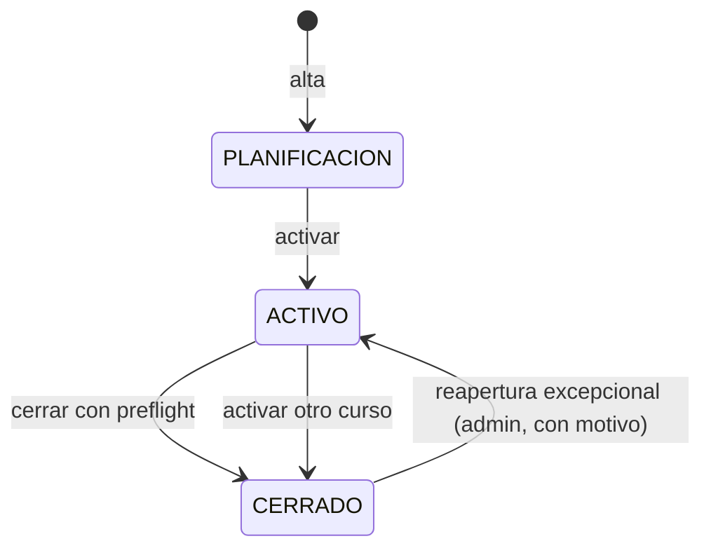

# Curso escolar

## Propósito

Identifica el periodo lectivo al que pertenecen matrículas, horarios y preparaciones. Es la dimensión temporal del histórico académico y permite saber qué curso está activo, cuáles están planificados y cuáles se han cerrado.

## Decisión de modelado

> [!success] Entidad ligera confirmada
> Se modela como **entidad** (tabla `curso_escolar`), no como valor textual repetido en cada tabla. Las matrículas, los horarios y las preparaciones referencian el curso mediante FK. Decisión registrada en [[ADR-008 - Curso escolar como entidad]].

## Campos

| Campo | Tipo | Obligatorio | Reglas |
| --- | --- | --- | --- |
| `id` | BIGINT | Sí | Clave primaria. |
| `mancomunidad_id` | BIGINT | Sí | FK a [[Mancomunidad]]; cada mancomunidad tiene sus propios cursos. |
| `codigo` | VARCHAR(9) | Sí | Único dentro de la mancomunidad; formato `YYYY-YYYY` (por ejemplo, `2026-2027`). |
| `fecha_inicio` | DATE | Sí | Inicio real del curso; por defecto el 1 de septiembre. |
| `fecha_fin` | DATE | Sí | Fin real del curso; por defecto el 31 de agosto del año siguiente. |
| `estado` | VARCHAR(20) | Sí | `PLANIFICACION`, `ACTIVO` o `CERRADO`. |
| `created_at` | DATETIME | Sí | Auditoría. |
| `updated_at` | DATETIME | Sí | Auditoría. |

## Relaciones

- **N:1 con [[Mancomunidad]]**.
- **1:N con [[Matrícula]]**.
- **1:N con [[Horario del profesor]]**.
- **1:N con [[Preparación de clase]]**.
- **1:N con [[Día no lectivo]]**.
- **1:N con [[Observación]]**.
- **1:N con [[Resumen de asistencia]]**.
- **1:N con [[Sesión de clase]]**.
- **1:N con [[Sustitución]]**.

## Reglas

- El código se compone de dos años consecutivos separados por guion: `2026-2027`.
- El curso empieza el **1 de septiembre** y termina el **31 de agosto** del año siguiente, salvo fechas excepcionales definidas por la administración.
- **Solo puede existir un curso `ACTIVO` por mancomunidad.** Se refuerza en base de datos con una columna generada que combina `mancomunidad_id` y `estado`, además de la validación en el servicio.
- Las matrículas, horarios, preparaciones, observaciones y días no lectivos solo pueden referenciar cursos de su misma mancomunidad.
- Transiciones permitidas: `PLANIFICACION` → `ACTIVO` → `CERRADO`. La reapertura de un curso cerrado es una acción administrativa excepcional.
- Los cursos `CERRADOS` bloquean las altas y ediciones de matrículas, horarios, franjas, preparaciones, observaciones, días no lectivos y sustituciones; la única escritura permitida es la corrección de asistencias de sesiones existentes ([[ADR-024 - Cierre y reapertura de curso escolar]]).
- **Al cerrar un curso no se borra nada.** Las sesiones `PROGRAMADA` sin asistencia pasan a `CANCELADA` con motivo «Cierre del curso»; los horarios y las matrículas conservan su estado pero quedan congelados; las sesiones `ABIERTA` o `CERRADA` no se tocan. La única escritura permitida después es la corrección de asistencias de sesiones existentes ([[ADR-024 - Cierre y reapertura de curso escolar]]).
- **La reapertura** solo la hace un administrador sobre un curso `CERRADO`, con motivo de 10–500 caracteres. Si hay otro curso `ACTIVO`, se cierra en la misma transacción. No reactiva las sesiones canceladas ni genera sesiones retroactivas.
- Activar un curso distinto cierra el anterior en la misma transacción con el mismo preflight.
- La copia de horarios al curso siguiente es una acción explícita y separada del cierre ([[ADR-023 - Copia de horario al curso siguiente]]).
- Las sustituciones pertenecen a un curso y no pueden salir de su rango de fechas ([[ADR-025 - Sustituciones y cambio de titular]]).
- No se borra físicamente un curso con datos asociados; se cierra.
- El curso activo se obtiene de la tabla, no se calcula en cada petición.
- Si no hay ningún curso activo, la aplicación muestra un error de configuración y la administración debe activar uno.
- El calendario de días no lectivos se define por curso y, opcionalmente, por centro; el generador de sesiones lo consulta antes de crear clases ([[ADR-017 - Cancelación de sesiones y días no lectivos]]).
- Las observaciones y el resumen de asistencia se agrupan por curso; una observación debe tener una fecha dentro del curso ([[ADR-018 - Curso escolar en las observaciones]]).
- La zona horaria de referencia es `Europe/Madrid`.

## Ciclo de vida

## Impacto técnico

- Nueva tabla `curso_escolar` con `mancomunidad_id`.
- FKs `curso_escolar_id` en `matricula`, `horario_profesor`, `preparacion_clase`, `sesion_clase`, `observacion`, `dia_no_lectivo` y `resumen_asistencia`.
- Restricción de unicidad del curso activo **por mancomunidad** mediante columna generada.
- Migración inicial con la mancomunidad de ejemplo y el curso `2026-2027` en estado `ACTIVO` para poder arrancar.
- Pantalla de administración para crear, activar y cerrar cursos; puede posponerse a la Fase 3.

## Dudas

- ¿Se permite más de un curso en `PLANIFICACION`? Sí, para preparar el siguiente.
- ¿Se puede reabrir un curso cerrado? Solo la administración y de forma excepcional; queda registrado en la auditoría básica.
- ~~¿Qué ocurre con las matrículas al cerrar un curso?~~ **Resuelto: se conservan como histórico, quedan congeladas y dejan de ser editables; la asistencia de sesiones existentes sí se puede corregir.** Véase [[ADR-024 - Cierre y reapertura de curso escolar]].
- ~~¿Cómo se representan los festivos y vacaciones?~~ **Resuelto: con [[Día no lectivo]] por curso y centro opcional; el generador no crea sesiones y cancela las `PROGRAMADA` sin asistencia.** Véase [[ADR-017 - Cancelación de sesiones y días no lectivos]].
- ~~¿Qué pasa con las sesiones `PROGRAMADA` al cerrar?~~ **Resuelto: se cancelan con motivo «Cierre del curso»; no se reactivan al reabrir.** Véase [[ADR-024 - Cierre y reapertura de curso escolar]].

## Relacionado

[[Mancomunidad]] · [[Multi-tenencia]] · [[Modelo de datos]] · [[Matrícula]] · [[Horario del profesor]] · [[Preparación de clase]] · [[Sesión de clase]] · [[Día no lectivo]] · [[Observación]] · [[Resumen de asistencia]] · [[Sustitución]] · [[ADR-008 - Curso escolar como entidad]] · [[ADR-017 - Cancelación de sesiones y días no lectivos]] · [[ADR-018 - Curso escolar en las observaciones]] · [[ADR-019 - Resumen de asistencia y purga anonimizada]] · [[ADR-023 - Copia de horario al curso siguiente]] · [[ADR-024 - Cierre y reapertura de curso escolar]] · [[Convenciones]]
