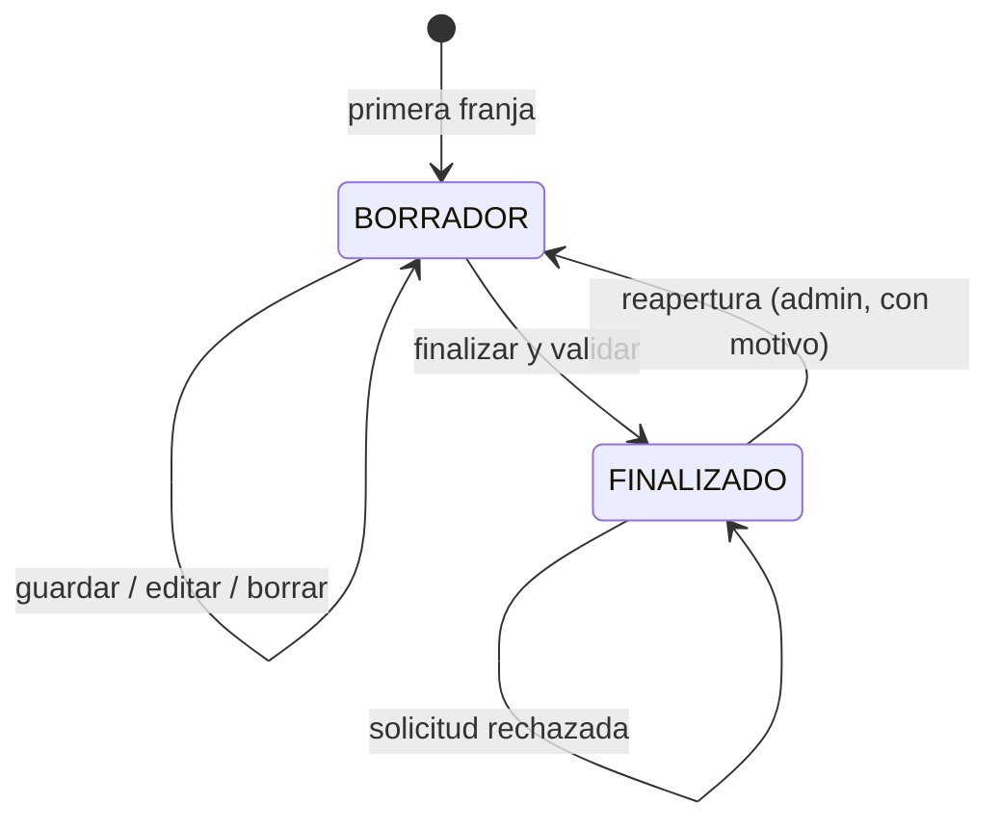

# Horario del profesor

## Propósito

Agrupa todas las franjas de un profesor durante un curso escolar y controla su ciclo de vida: **borrador** mientras se construye y **finalizado** cuando ya está cerrado. Es el punto de entrada para saber si se puede editar directamente o hay que solicitar un cambio. Lo puede construir el **profesor titular** o un **administrador de la mancomunidad**; solo un administrador puede reabrirlo, con motivo y auditoría, y únicamente cuando está finalizado por completo.

## Campos

| Campo | Tipo | Obligatorio | Reglas |
| --- | --- | --- | --- |
| `id` | BIGINT | Sí | Clave primaria. |
| `mancomunidad_id` | BIGINT | Sí | FK a [[Mancomunidad]]; tenant del horario. |
| `profesor_id` | BIGINT | Sí | FK a [[Usuario]] con pertenencia activa `PROFESOR` en esa mancomunidad. |
| `curso_escolar_id` | BIGINT | Sí | FK a [[Curso escolar]] de la misma mancomunidad. |
| `estado` | VARCHAR(20) | Sí | `BORRADOR` o `FINALIZADO`. |
| `finalizado_at` | DATETIME | No | Fecha de la última finalización. |
| `creado_por` | BIGINT | Sí | FK a [[Usuario]] que creó el horario (profesor titular o administrador). |
| `actualizado_por` | BIGINT | Sí | FK a [[Usuario]] de la última modificación. |
| `created_at` | DATETIME | Sí | Auditoría. |
| `updated_at` | DATETIME | Sí | Auditoría. |

## Relaciones

- **N:1 con [[Mancomunidad]]**.
- **N:1 con [[Usuario]]** (profesor).
- **1:N con [[Franja horaria]]**.
- **1:N con [[Solicitud de cambio de horario]]**.
- **1:N con [[Historial de horario]]**.
- **N:1 con [[Curso escolar]]**.
- **Sin relación directa con [[Sustitución]]**: la sustitución afecta a las sesiones, no al horario ni a sus franjas.

## Reglas

- Solo existe un horario por profesor, curso y mancomunidad: `UNIQUE (mancomunidad_id, profesor_id, curso_escolar_id)`.
- El profesor debe tener una pertenencia activa como `PROFESOR` en la mancomunidad del horario.
- El curso escolar debe pertenecer a la misma mancomunidad.
- Al crear la primera franja se crea el horario en estado `BORRADOR`, con `creado_por` y `actualizado_por` del usuario que la creó.
- Mientras está en `BORRADOR`, el profesor titular y cualquier administrador de la mancomunidad pueden crear, editar y eliminar franjas y guardar de forma parcial.
- El administrador puede crear el horario de cualquier profesor con pertenencia activa `PROFESOR` en su mancomunidad; el profesor solo opera sobre el suyo.
- Para finalizar se validan conflictos de profesor, grupo y alumno, horas y que exista al menos una franja. Puede finalizar el profesor titular o un administrador.
- El **conflicto de alumno** se calcula con las matrículas `ACTIVA` de las asignaturas: dos franjas solapadas del mismo curso que comparten alumno son inválidas aunque sean de grupos distintos ([[ADR-021 - Validación de conflictos de alumno]]).
- Los conflictos de profesor se validan solo **dentro de la mancomunidad**; un mismo profesor global puede tener horarios en dos tenants y el sistema no comprueba sus solapamientos entre ellos ([[ADR-022 - Conflictos de profesor entre mancomunidades]]).
- Al finalizar se guarda `finalizado_at`, se escribe una fila `FINALIZACION` en [[Historial de horario]] con el autor y se bloquea la edición directa.
- Tras la finalización, cualquier cambio de contenido se canaliza mediante [[Solicitud de cambio de horario]] o una reapertura administrativa.
- El administrador ya no está limitado a consultar: puede construir y corregir el horario mientras esté en `BORRADOR`.
- El profesor puede solicitar la modificación de un horario finalizado; el administrador decide.
- **Reapertura:** solo un administrador puede devolver un horario `FINALIZADO` a `BORRADOR`, y solo cuando está finalizado por completo. Exige un motivo de 10–500 caracteres, se registra en [[Historial de horario]] y devuelve el control de las franjas al profesor y a la administración.
- La reapertura **no modifica ni elimina franjas** y **cancela las solicitudes pendientes** de ese horario, que pasan a `CANCELADA` con la respuesta «Cancelada por reapertura del horario».
- Un horario puede finalizarse y reabrirse varias veces; cada transición queda auditada.
- El profesor no puede reabrir su propio horario ni volver a `BORRADOR` por su cuenta.
- La edición normal del administrador no exige motivo: la autoría queda en `actualizado_por` y en el historial de estados cuando finaliza.
- **Copia a otro curso:** `POST /horarios/{id}/copiar` crea un horario nuevo en `BORRADOR` para el mismo profesor y el curso destino, copia solo las franjas válidas y devuelve las omitidas. No copia sesiones, solicitudes ni historial; se registra `COPIA` en [[Historial de horario]] con `origen_horario_id` ([[ADR-023 - Copia de horario al curso siguiente]]).
- **Curso cerrado:** un horario de un curso `CERRADO` queda congelado. Conserva su estado, pero no se crean ni editan franjas hasta que el curso se reabra ([[ADR-024 - Cierre y reapertura de curso escolar]]).
- **Sustitución:** el horario sigue perteneciendo al titular. Una [[Sustitución]] activa no cambia `profesor_id` ni las franjas; solo reasigna las sesiones del periodo al sustituto ([[ADR-025 - Sustituciones y cambio de titular]]).

## Flujo

## Vistas de rejilla

- **Por profesor:** sus franjas de lunes a domingo. El profesor titular y el administrador la editan mientras el horario está en `BORRADOR`; después queda bloqueada salvo reapertura.
- **Por grupo:** todas las asignaturas del mismo `centroId + curso + grupo`, con el profesor de cada franja. Es siempre de solo lectura, también para el profesor.
- El administrador ve cualquier grupo; el profesor solo aquellos donde imparte alguna asignatura y recibe `404` en los demás.
- Los días vacíos también forman parte de la vista: la rejilla siempre tiene siete columnas.

## Dudas

- ~~¿Puede el administrador reabrir un horario finalizado?~~ **Resuelto: sí, solo desde `FINALIZADO`, con motivo obligatorio y auditoría; no edita franjas finalizadas y cancela las solicitudes pendientes.**
- ~~¿Puede el administrador crear o editar el horario de un profesor?~~ **Resuelto: sí, mientras está en `BORRADOR`, incluida la finalización; la autoría queda registrada ([[ADR-016 - Horario editable por profesor y administrador]]).**
- ~~¿Se valida que un alumno no tenga dos clases a la misma hora?~~ **Resuelto: sí, al crear o editar franjas, al finalizar y al matricular.** Véase [[ADR-021 - Validación de conflictos de alumno]].
- ~~¿Se validan los solapamientos de un profesor entre mancomunidades?~~ **Resuelto: no en la v1; el aislamiento impide consultar el horario de otro tenant.** Véase [[ADR-022 - Conflictos de profesor entre mancomunidades]].
- ~~¿Cómo se reutiliza el horario al abrir un curso nuevo?~~ **Resuelto: con una copia explícita a `BORRADOR` que omite las franjas no válidas y no arrastra sesiones ni solicitudes.** Véase [[ADR-023 - Copia de horario al curso siguiente]].
- ~~¿Qué pasa con el horario al cerrar el curso?~~ **Resuelto: se conserva y se congela; no se borra ni cambia de estado.** Véase [[ADR-024 - Cierre y reapertura de curso escolar]].
- ~~¿Cambia el horario cuando un profesor es sustituido?~~ **Resuelto: no; la sustitución solo afecta a las sesiones del periodo.** Véase [[ADR-025 - Sustituciones y cambio de titular]].
- ¿Qué ocurre si el profesor no tiene ninguna franja? No se permite finalizar.
- ¿Se puede finalizar un horario con asignaturas inactivas? No; se valida antes.
- ~~¿El estado es por profesor y curso o por curso completo?~~ **Resuelto: por profesor y curso, con `UNIQUE (mancomunidad_id, profesor_id, curso_escolar_id)`.**

## Relacionado

[[Mancomunidad]] · [[Multi-tenencia]] · [[Franja horaria]] · [[Solicitud de cambio de horario]] · [[Historial de horario]] · [[Usuario]] · [[Curso escolar]] · [[Alumno]] · [[Matrícula]] · [[Sustitución]] · [[ADR-004 - Horario gestionado por el profesor]] · [[ADR-016 - Horario editable por profesor y administrador]] · [[ADR-023 - Copia de horario al curso siguiente]] · [[ADR-024 - Cierre y reapertura de curso escolar]] · [[ADR-025 - Sustituciones y cambio de titular]] · [[ADR-008 - Curso escolar como entidad]] · [[ADR-021 - Validación de conflictos de alumno]] · [[ADR-022 - Conflictos de profesor entre mancomunidades]] · [[Modelo de datos]]
