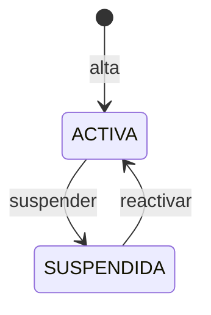

# Mancomunidad

## Propósito

Representa a una mancomunidad de centros de enseñanza y actúa como **tenant** del sistema: la unidad de aislamiento, configuración y administración. Agrupa centros, cursos escolares, instrumentos y pertenencias de usuarios. Su origen es una mancomunidad de escuelas de música, pero el modelo admite cualquier área: danza, artes escénicas, idiomas, deportes u otras.

No debe confundirse con [[Centro]]: una mancomunidad contiene varios centros.

## Campos

| Campo | Tipo | Obligatorio | Reglas |
| --- | --- | --- | --- |
| `id` | BIGINT | Sí | Clave primaria. |
| `nombre` | VARCHAR(150) | Sí | Único a nivel de plataforma; 2–150 caracteres. |
| `codigo` | VARCHAR(30) | Sí | Único; minúsculas, números y guiones; inmutable desde el alta y nunca reutilizado. |
| `tipo` | VARCHAR(30) | Sí | `MUSICA`, `DANZA`, `ARTES_ESCENICAS`, `IDIOMAS`, `DEPORTES` u `OTRO`; informativo, no limita las asignaturas. |
| `duracion_maxima_franja_min` | INT | No | Máximo opcional de duración de una franja, en minutos; nulo = sin máximo. |
| `activo` | BOOLEAN | Sí | Por defecto `true`. |
| `created_at` | DATETIME | Sí | Auditoría. |
| `updated_at` | DATETIME | Sí | Auditoría. |

## Relaciones

- **1:N con [[Centro]]**.
- **1:N con [[Curso escolar]]**.
- **1:N con [[Instrumento]]**.
- **1:N con [[UsuarioMancomunidad]]**.
- **1:N con la auditoría de plataforma**, cuando una acción de soporte o de ciclo de vida afecta a esta mancomunidad.
- **1:N con el resto de entidades de negocio** (`Asignatura`, `Alumno`, `Matrícula`, `Horario del profesor`, `Franja horaria`, `Sesión de clase`, `Asistencia`, `Historial de asistencia`, `Observación`, `Preparación de clase` y `Solicitud de cambio de horario`), todas con `mancomunidad_id`.

> [!note] Relación implícita
> No todas las aristas se dibujan en los diagramas, pero toda fila de negocio debe poder rastrearse hasta una mancomunidad. La pertenencia del usuario se modela aparte en [[UsuarioMancomunidad]].

## Reglas

- El `codigo` se fija al crear la mancomunidad y **no se modifica nunca**; tampoco se reutiliza para otra mancomunidad, aunque la original se suspenda.
- El `codigo` es una etiqueta legible para pantallas, exportaciones e integraciones: **no decide el tenant**. El aislamiento se resuelve siempre por el token y el `mancomunidad_id`, nunca por el código.
- El código no forma parte de URLs ni de subdominios en la v1.
- Si cambia el nombre, el código se mantiene.
- El nombre es único para evitar ambigüedad en el panel de plataforma.
- No se borra físicamente: se **suspende** (`activo = false`).
- Una mancomunidad suspendida no permite iniciar sesión ni operar en ella; solo la plataforma puede reactivarla.
- Cada mancomunidad tiene su propio curso escolar activo.
- Cada mancomunidad tiene su propio catálogo de instrumentos, visible solo si alguna asignatura activa los usa.
- El `tipo` describe la orientación principal de la mancomunidad y es **informativo**: no limita las asignaturas, de modo que una mancomunidad de música puede ofertar idiomas y una de idiomas puede ofertar música.
- El `tipo` se elige al crear la mancomunidad y solo un `SUPERADMIN` puede cambiarlo después, con motivo y auditoría; cambiarlo no altera las asignaturas existentes.
- Los módulos disponibles dependen de los datos, no del tipo: el de instrumentos se activa si existe al menos una asignatura activa con `requiere_instrumento = true` ([[ADR-015 - Tipos de enseñanza y módulo de instrumentos opcional]]).
- La duración máxima de una franja es opcional y se configura por mancomunidad; nula significa sin máximo.
- Los datos de una mancomunidad no son visibles desde otra, ni siquiera para un administrador de la otra.
- La creación de una mancomunidad siembra su primer administrador y su curso inicial.
- Solo un `SUPERADMIN` de plataforma puede crear, suspender o reactivar mancomunidades.
- El soporte de plataforma puede administrar las cuentas de la mancomunidad, pero no leer ni modificar sus datos académicos.

## Ciclo de vida

## Dudas

- ~~¿Se permite cambiar el código?~~ **Resuelto: no; es inmutable desde el alta, no se reutiliza y no se usa para resolver el tenant, en URLs ni en subdominios.**
- ¿Se guardan datos de contacto o facturación? Fuera de la v1; se pueden añadir después.
- ~~¿Puede una mancomunidad tener subdominio propio?~~ **Resuelto para la v1: no; un único origen y el código no se usa como subdominio. Se revisará solo si el despliegue lo exige.**
- ~~¿El tipo de mancomunidad limita las asignaturas?~~ **Resuelto: no; es informativo y una mancomunidad puede mezclar áreas ([[ADR-015 - Tipos de enseñanza y módulo de instrumentos opcional]]).**

## Relacionado

[[Multi-tenencia]] · [[ADR-009 - Multi-tenant con mancomunidad e identidad global]] · [[ADR-012 - Soporte de cuentas del superadministrador]] · [[ADR-015 - Tipos de enseñanza y módulo de instrumentos opcional]] · [[Centro]] · [[Curso escolar]] · [[Asignatura]] · [[Instrumento]] · [[UsuarioMancomunidad]] · [[Modelo de datos]]
