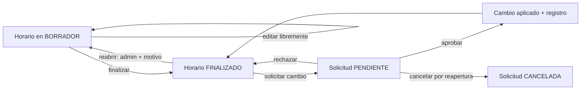

# Solicitud de cambio de horario

## Propósito

Petición que un profesor envía a la administración para crear, modificar o eliminar una franja **una vez que su horario está finalizado**. Sirve para dejar registro del cambio y que la administración lo autorice. Mientras el horario está en borrador, el profesor o el administrador editan directamente y no hace falta solicitud.

## Campos

| Campo | Tipo | Obligatorio | Reglas |
| --- | --- | --- | --- |
| `id` | BIGINT | Sí | Clave primaria. |
| `mancomunidad_id` | BIGINT | Sí | FK a [[Mancomunidad]]; tenant de la solicitud. |
| `profesor_id` | BIGINT | Sí | FK a [[Usuario]] con pertenencia activa en esa mancomunidad. |
| `horario_profesor_id` | BIGINT | Sí | FK a [[Horario del profesor]] de la misma mancomunidad. |
| `franja_id` | BIGINT | No | FK a [[Franja horaria]] de la misma mancomunidad; nulo si es una creación. |
| `tipo` | VARCHAR(20) | Sí | `CREAR`, `MODIFICAR` o `ELIMINAR`. |
| `asignatura_id` | BIGINT | Sí | Asignatura afectada, de la misma mancomunidad. |
| `dia_semana_propuesto` | TINYINT | No | 1–7. |
| `hora_inicio_propuesta` | TIME | No | Nueva hora de inicio. |
| `hora_fin_propuesta` | TIME | No | Nueva hora de fin. |
| `aula_propuesta` | VARCHAR(100) | No | Nueva aula. |
| `motivo` | TEXT | Sí | Explicación del cambio. |
| `estado` | VARCHAR(20) | Sí | `PENDIENTE`, `APROBADA`, `RECHAZADA` o `CANCELADA`. |
| `respuesta_admin` | TEXT | No | Comentario al resolver. |
| `resuelta_por` | BIGINT | No | FK a [[Usuario]] administrador. |
| `resuelta_at` | DATETIME | No | Fecha de resolución. |
| `created_at` | DATETIME | Sí | Auditoría. |
| `updated_at` | DATETIME | Sí | Auditoría. |

## Relaciones

- **N:1 con [[Mancomunidad]]**.
- **N:1 con [[Usuario]]** (profesor solicitante).
- **N:1 con [[Horario del profesor]]**.
- **N:1 con [[Franja horaria]]** (opcional).
- **N:1 con [[Asignatura]]**.
- **N:1 con [[Usuario]]** (administrador que resuelve).

## Reglas

- Todos los recursos de la solicitud deben pertenecer a la misma mancomunidad.
- Solo se pueden crear solicitudes cuando el [[Horario del profesor]] está `FINALIZADO`.
- La reapertura administrativa del horario cancela automáticamente las solicitudes `PENDIENTE` de ese horario.
- Mientras el horario está en `BORRADOR`, el profesor titular o un administrador editan directamente y no necesitan solicitud.
- Solo el profesor puede crear solicitudes sobre su propio horario; el administrador que quiera cambiar un horario finalizado lo reabre con motivo.
- Solo puede existir una solicitud `PENDIENTE` por franja.
- Para una creación, solo puede existir una solicitud pendiente con el mismo día y hora de inicio dentro del horario.
- La solicitud debe indicar los datos propuestos y un motivo.
- Solo el administrador puede aprobar o rechazar.
- Al aprobar se revalidan solapamientos y se aplica el cambio al horario en una única transacción.
- Si la validación falla, la solicitud no se aprueba y se devuelve el motivo.
- El profesor puede cancelar su propia solicitud mientras esté pendiente.
- El histórico de solicitudes se conserva y es visible para administración.
- El profesor ve sus propias solicitudes y su estado, pero no el historial completo de cambios del sistema.

## Flujo

## Dudas

- ¿Puede el administrador crear una solicitud en nombre de un profesor? No en la v1; si necesita cambiar un horario finalizado, lo reabre con motivo y auditoría ([[ADR-016 - Horario editable por profesor y administrador]]).
- ¿Se notifica al profesor? Solo se verá en su listado; no hay notificaciones de negocio por email. El correo transaccional se reserva para la recuperación de contraseña ([[ADR-011 - Recuperación de contraseña y correo transaccional]]).
- ~~¿Se puede reabrir un horario finalizado sin solicitud?~~ **Resuelto: sí, pero solo un administrador y con motivo auditado; la reapertura cancela las solicitudes pendientes.**

## Relacionado

[[Mancomunidad]] · [[Multi-tenencia]] · [[Horario del profesor]] · [[Franja horaria]] · [[Usuario]] · [[Asignatura]] · [[ADR-004 - Horario gestionado por el profesor]] · [[ADR-016 - Horario editable por profesor y administrador]] · [[ADR-011 - Recuperación de contraseña y correo transaccional]] · [[Modelo de datos]]
