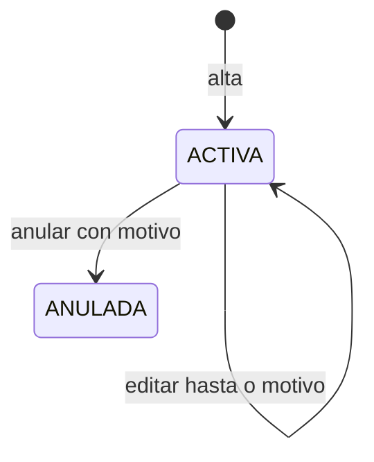

# Sustitución

## Propósito

Acota un periodo en el que un profesor sustituto imparte una [[Asignatura]] en lugar de su profesor titular. No cambia el [[Horario del profesor]] ni crea franjas nuevas: solo decide quién imparte las [[Sesión de clase|sesiones]] de esa asignatura dentro del periodo. Decisión en [[ADR-025 - Sustituciones y cambio de titular]].

## Campos

| Campo | Tipo | Obligatorio | Reglas |
| --- | --- | --- | --- |
| `id` | BIGINT | Sí | Clave primaria. |
| `mancomunidad_id` | BIGINT | Sí | FK a [[Mancomunidad]]; tenant de la sustitución. |
| `curso_escolar_id` | BIGINT | Sí | FK a [[Curso escolar]] de la misma mancomunidad. |
| `asignatura_id` | BIGINT | Sí | FK a [[Asignatura]] activa de la misma mancomunidad. |
| `profesor_titular_id` | BIGINT | Sí | FK a [[Usuario]] con pertenencia activa `PROFESOR`; debe impartir la asignatura. |
| `profesor_sustituto_id` | BIGINT | Sí | FK a [[Usuario]] con pertenencia activa `PROFESOR` en la misma mancomunidad; distinto del titular. |
| `desde` | DATE | Sí | Inicio inclusivo; dentro del curso y no posterior a `hasta`. |
| `hasta` | DATE | Sí | Fin inclusivo; dentro del curso. |
| `motivo` | VARCHAR(500) | Sí | 10–500 caracteres. |
| `estado` | VARCHAR(20) | Sí | `ACTIVA` o `ANULADA`. |
| `anulada_at` | DATETIME | No | Nulo salvo en `ANULADA`. |
| `anulada_por` | BIGINT | No | FK a [[Usuario]]; obligatorio si `ANULADA`. |
| `motivo_anulacion` | VARCHAR(500) | No | 10–500 caracteres; obligatorio si `ANULADA`. |
| `creado_por` | BIGINT | Sí | FK a [[Usuario]] administrador que la crea. |
| `actualizado_por` | BIGINT | Sí | FK a [[Usuario]] de la última modificación. |
| `created_at` | DATETIME | Sí | Auditoría. |
| `updated_at` | DATETIME | Sí | Auditoría. |

## Relaciones

- **N:1 con [[Mancomunidad]]**.
- **N:1 con [[Curso escolar]]**.
- **N:1 con [[Asignatura]]**.
- **N:1 con [[Usuario]]** como profesor titular, profesor sustituto y autor de la anulación.
- **1:N con [[Sesión de clase]]**: las sesiones del periodo guardan `sustitucion_id`.

## Reglas

- Solo la administración crea, edita y anula sustituciones; el profesor titular y el sustituto solo consultan.
- Asignatura, curso, titular y sustituto deben pertenecer a la misma mancomunidad.
- El titular debe impartir la asignatura y el sustituto debe tener pertenencia activa `PROFESOR`; no puede ser el mismo usuario.
- No puede haber dos sustituciones `ACTIVA` solapadas para la misma asignatura y curso.
- El sustituto no puede tener otra sustitución `ACTIVA` solapada ni una franja de un horario `FINALIZADO` que se pise con las franjas de la asignatura sustituida. Los solapes se devuelven como `422` con `conflictos`.
- Las fechas son inclusivas y deben estar dentro del curso escolar.
- Al crear la sustitución, las sesiones `PROGRAMADA` del periodo sin lista se reasignan al sustituto y guardan `sustitucion_id`; las `ABIERTA` y `CERRADA` no se tocan.
- La generación diaria usa al sustituto cuando la fecha cae dentro de una sustitución `ACTIVA`.
- Al anular o acortar `hasta`, las sesiones `PROGRAMADA` futuras sin lista vuelven al titular y limpian `sustitucion_id`; las ya abiertas o cerradas se conservan.
- La sustitución no modifica el [[Horario del profesor]] ni sus [[Franja horaria]]: el titular sigue siendo el dueño del horario.
- Durante la sustitución, el sustituto puede abrir, cerrar y pasar lista en las sesiones afectadas; el titular las ve en solo lectura.
- El titular conserva el acceso a su horario y a la consulta de la sustitución, pero no edita las sesiones del periodo.
- Anular no borra la fila ni las sesiones; exige `motivo_anulacion` y conserva la traza.
- Si el sustituto pierde la pertenencia `PROFESOR`, la sustitución debe anularse antes; si no, la generación del periodo falla con un error de configuración y no crea sesiones sin profesor válido.

## Ciclo de vida

## Dudas

- ¿Puede el titular cancelar su propia sustitución? No; la cobertura la decide la administración.
- ¿Se puede sustituir a un sustituto? Sí, cerrando la sustitución anterior y creando otra; no se solapan.
- ¿La sustitución cambia el profesor del horario? No. Solo afecta a las sesiones del periodo.
- ¿Qué pasa con las sesiones ya impartidas si se anula la sustitución? Se conservan con el profesor que las tenía; la anulación solo revierte las `PROGRAMADA` futuras.

## Relacionado

[[Mancomunidad]] · [[Multi-tenencia]] · [[Curso escolar]] · [[Asignatura]] · [[Usuario]] · [[Horario del profesor]] · [[Franja horaria]] · [[Sesión de clase]] · [[Modelo de datos]] · [[API REST]] · [[ADR-025 - Sustituciones y cambio de titular]]
