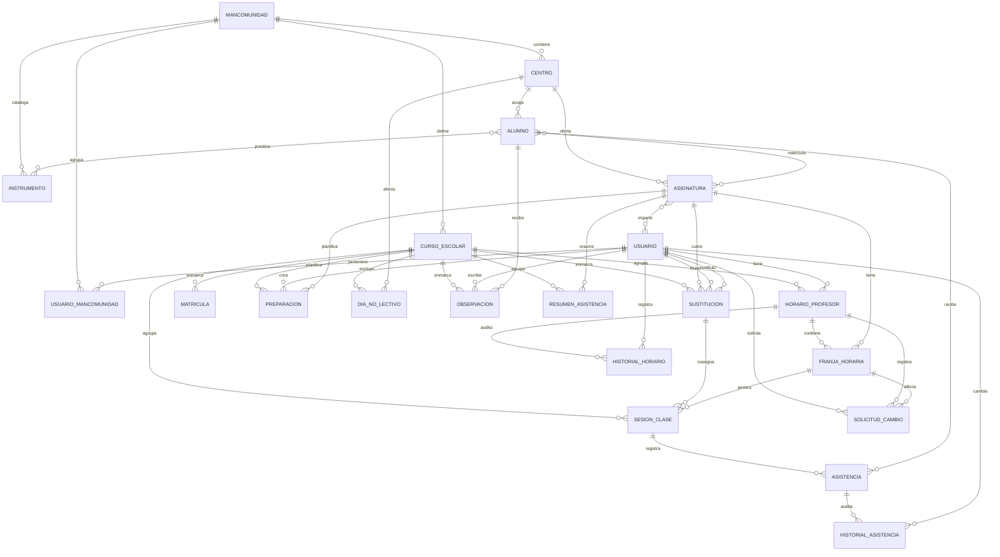

# Modelo de dominio

> [!info] Nivel conceptual
> Esta nota describe las entidades, sus relaciones y las reglas que deben cumplirse. El detalle físico (tablas, columnas, índices) está en [[Modelo de datos]] y se cerrará en la Fase 1.

## 1. Principios

- **Un solo contexto delimitado:** gestión académica de mancomunidades de centros de enseñanza de cualquier área (música, danza, artes escénicas, idiomas, deportes…), con una base de datos compartida y aislamiento por `mancomunidad_id`. No se divide en microservicios.
- **Identidad global, rol por mancomunidad:** un usuario puede pertenecer a varias mancomunidades con roles distintos.
- **Entidades con identidad propia:** mancomunidad, usuario, centro, asignatura, alumno, instrumento, horario, historial de horario, franja, sesión, asistencia, resumen de asistencia, día no lectivo, observación, preparación y solicitud.
- **Relaciones N:M explícitas** cuando aportan datos (matrícula, asignatura–profesor, alumno–instrumento).
- **Borrado lógico** en datos maestros (`activo`); el histórico se conserva.
- **Auditoría básica** en todas las tablas editables y **historial específico** para la asistencia y los estados del horario.

## 2. Mapa de entidades

| Entidad | Responsabilidad | Nota |
| --- | --- | --- |
| Mancomunidad | Tenant: agrupa centros, cursos, asignaturas, instrumentos y pertenencias; su tipo es informativo. | [[Mancomunidad]] |
| Usuario | Identidad global: credenciales y estado de la cuenta. | [[Usuario]] |
| UsuarioMancomunidad | Pertenencia y rol de un usuario dentro de una mancomunidad. | [[UsuarioMancomunidad]] |
| Centro | Centro de enseñanza de la mancomunidad, de cualquier área. | [[Centro]] |
| Asignatura | Materia, nivel y grupo ofertados por un centro, con tipo y uso opcional de instrumento. | [[Asignatura]] |
| Alumno | Persona matriculada, con tutores e instrumentos si el módulo está activo. | [[Alumno]] |
| Instrumento | Catálogo reutilizable de instrumentos musicales, módulo opcional. | [[Instrumento]] |
| Matrícula | Vinculación alumno–asignatura por curso. | [[Matrícula]] |
| Curso escolar | Periodo lectivo y su estado. | [[Curso escolar]] |
| Día no lectivo | Fecha sin actividad lectiva por mancomunidad o centro. | [[Día no lectivo]] |
| Horario del profesor | Conjunto de franjas de un profesor en un curso y su estado. | [[Horario del profesor]] |
| Sustitución | Periodo en que un profesor sustituto imparte una asignatura en lugar del titular. | [[Sustitución]] |
| Historial de horario | Traza inmutable de creación, finalización, reapertura y copia del horario. | [[Historial de horario]] |
| Franja horaria | Bloque de clase semanal. | [[Franja horaria]] |
| Sesión de clase | Encuentro concreto de una asignatura en una fecha. | [[Sesión de clase]] |
| Asistencia | Estado de un alumno en una sesión. | [[Asistencia]] |
| Historial de asistencia | Traza de cada cambio de asistencia. | [[Historial de asistencia]] |
| Resumen de asistencia | Contadores anonimizados por alumno, asignatura y curso tras la purga. | [[Resumen de asistencia]] |
| Observación | Anotación docente sobre un alumno. | [[Observación]] |
| Preparación de clase | Planificación docente de una sesión o fecha. | [[Preparación de clase]] |
| Solicitud de cambio | Petición de alta, modificación o baja de una franja finalizada. | [[Solicitud de cambio de horario]] |

## 3. Diagrama conceptual

> [!info] Lectura del diagrama
> Las entidades de negocio cuelgan de `MANCOMUNIDAD`, aunque el diagrama omita esas aristas para no perder legibilidad. Las relaciones `USUARIO → ASIGNATURA`, `USUARIO → HORARIO_PROFESOR`, etc. siempre están mediadas por una pertenencia activa en la mancomunidad correspondiente.

## 4. Invariantes del dominio

> [!important] Reglas que siempre deben cumplirse
> 1. Un usuario tiene un email global único y puede tener varias pertenencias, cada una con un rol.
> 2. Una asignatura pertenece a un centro y tiene un nombre único dentro de mancomunidad + centro + curso + grupo.
> 3. Un profesor solo puede tener franjas de asignaturas que imparte.
> 4. Un profesor no puede tener dos franjas solapadas en el mismo curso escolar.
> 5. Un grupo (centro + curso + grupo) no puede tener dos asignaturas solapadas.
> 6. Una matrícula solo puede existir entre un alumno y una asignatura del mismo centro.
> 7. Una sesión de clase pertenece a una asignatura y a un profesor; sus asistentes deben estar matriculados.
> 8. No puede haber dos asistencias para el mismo alumno en la misma sesión.
> 9. Cada cambio de asistencia genera una fila inmutable en el historial.
> 10. Una observación pertenece a un alumno y a un profesor; el profesor debe impartirle clase.
> 11. Una preparación pertenece a una asignatura que imparte el profesor.
> 12. Solo se elimina una preparación en estado `BORRADOR`.
> 13. Una solicitud pendiente no puede duplicarse para la misma franja.
> 14. Solo se solicita cambio de horario cuando el horario está `FINALIZADO`.
> 15. Los datos maestros no se borran físicamente; se desactivan.
> 16. Solo puede existir un curso escolar en estado `ACTIVO` **por mancomunidad**; los cerrados son de solo lectura.
> 17. Toda entidad de negocio lleva `mancomunidad_id` y todas las referencias apuntan a filas de la misma mancomunidad.
> 18. El rol se obtiene de `UsuarioMancomunidad`; nunca es global ni se acepta desde el cuerpo de la petición.
> 19. Un usuario sin pertenencia activa (y sin acceso de plataforma) no puede operar en ninguna mancomunidad.
> 20. Un recurso de otra mancomunidad se comporta como inexistente (`404`) para el usuario autenticado.
> 21. Solo un administrador reabre un horario y solo si está `FINALIZADO`; la reapertura exige motivo, se audita, no altera franjas y cancela las solicitudes pendientes.
> 22. El historial de asistencia se conserva mientras la matrícula está activa y 2 años desde la baja; después se purga y solo quedan los contadores anonimizados de [[Resumen de asistencia]].
> 23. Una contraseña temporal obliga a cambiarla antes de operar y caduca a las 24 horas.
> 24. El soporte de plataforma administra cuentas de cualquier mancomunidad, pero no accede a los datos académicos ni impersona usuarios.
> 25. No hay duración mínima de franja; el máximo es opcional por mancomunidad y, si no se define, solo se valida que el fin sea posterior al inicio.
> 26. Cada madrugada se genera una sesión `PROGRAMADA` por franja del día; la lista de alumnos se carga solo al abrirla, y las sesiones sin lista quedan pendientes y recuperables.
> 27. Tras 5 fallos por cuenta o 20 por IP en 15 minutos, el login se bloquea 15 minutos; el bloqueo no revoca sesiones abiertas y solo el `SUPERADMIN` lo levanta antes de caducar.
> 28. La rejilla semanal tiene dos vistas: la del profesor, editable en `BORRADOR` por el profesor titular o un administrador, y la del grupo, siempre de solo lectura y con todas sus asignaturas; el profesor solo accede a los grupos donde imparte.
> 29. El código de una mancomunidad es inmutable, no se reutiliza y no decide el tenant: no se usa en URLs ni subdominios y solo sirve como etiqueta legible.
> 30. Las FKs son simples; antes de guardar, el servicio comprueba que cada relación une filas de la misma mancomunidad y los tests de aislamiento lo verifican.
> 31. El tipo de una mancomunidad es informativo y no limita las asignaturas: una misma mancomunidad puede mezclar áreas.
> 32. Toda asignatura tiene un tipo de la lista cerrada y `requiere_instrumento` solo puede ser `true` si su tipo es `MUSICA`.
> 33. El módulo de instrumentos está activo si existe al menos una asignatura activa con `requiere_instrumento = true`; si no, se oculta sin borrar datos y la API rechaza operaciones de instrumentos con `422`.
> 34. Mientras un horario está en `BORRADOR`, lo pueden crear, editar y finalizar el profesor titular y cualquier administrador de la misma mancomunidad; la autoría queda registrada y, tras `FINALIZADO`, ambos pierden la edición directa.
> 35. Un alumno no puede tener dos franjas solapadas en el mismo curso, aunque sean de asignaturas o grupos distintos; el conflicto se valida al crear o editar la franja, al finalizar y al matricular.
> 36. Un día no lectivo impide generar sesiones en su ámbito y cancela las `PROGRAMADA` sin asistencia; no afecta a las sesiones con lista.
> 37. Una sesión `CANCELADA` solo viene de `PROGRAMADA`, no tiene asistencias, no cuenta en los contadores y no se reabre.
> 38. Toda observación tiene un `curso_escolar_id` obligatorio y su fecha debe estar dentro de ese curso.
> 39. La purga por retención conserva solo [[Resumen de asistencia]] con `alumno_hash`, asignatura y curso; no deja datos personales directos.
> 40. Al borrar una franja, las sesiones `PROGRAMADA` sin asistencia se eliminan y las que tienen lista se conservan con `franja_id` nulo y su instantánea propia.
> 41. Los conflictos de profesor se validan solo dentro de una mancomunidad; entre mancomunidades distintas no se comprueban en la v1.
> 42. Copiar un horario crea otro en `BORRADOR` para el curso destino, copia solo franjas válidas, no arrastra sesiones ni solicitudes y registra `COPIA` con `origen_horario_id`.
> 43. Cerrar un curso no borra datos: cancela las sesiones `PROGRAMADA` sin asistencia, congela horarios y matrículas, no genera sesiones nuevas y solo permite corregir asistencias existentes.
> 44. Reabrir un curso es una acción exclusiva del administrador, con motivo; cierra el curso activo en la misma transacción y no reactiva sesiones canceladas ni genera sesiones retroactivas.
> 45. Una sustitución cubre una asignatura y curso durante un periodo, no cambia el horario del titular y no puede solaparse con otra sustitución de la misma asignatura ni con la disponibilidad del sustituto.
> 46. Las sesiones del periodo de sustitución se asignan al sustituto y guardan `sustitucion_id`; las ya abiertas o cerradas conservan al profesor que las impartió.
> 47. La baja de una matrícula no borra asistencias ni historial: excluye al alumno de las listas que se abran desde la baja y la reactivación lo devuelve a las listas futuras.
> 48. El alumno es local a la mancomunidad: no tiene identidad global ni se deduplica entre tenants, y la plataforma no busca menores.

## 5. Agregados y transacciones

| Agregado | Raíz | Operaciones transaccionales |
| --- | --- | --- |
| Plataforma | Mancomunidad | Alta, suspensión y reactivación de mancomunidades; siembra de administrador y curso inicial. |
| Identidad | Usuario | Alta global, credenciales, activación y pertenencias. |
| Soporte de cuentas | Usuario | Búsqueda global, reset con cambio obligatorio, activación o desactivación y cambio de rol, con motivo y auditoría. |
| Pertenencia | UsuarioMancomunidad | Alta, cambio de rol y desactivación dentro de una mancomunidad. |
| Usuarios | Usuario | Alta, edición, activación, reset de contraseña. |
| Estructura académica | Centro / Asignatura | Alta de centro, asignatura y asignación de profesores. |
| Alumnado | Alumno | Alta, edición, instrumentos y matrículas. |
| Horario | Horario del profesor | Guardar borrador, finalizar, reabrir con motivo, copiar a otro curso y validar solapamientos de profesor, grupo y alumno; el profesor titular y el administrador pueden construir el borrador. |
| Curso | Curso escolar | Cerrar con preflight (cancelar sesiones `PROGRAMADA` sin asistencia, congelar horarios y matrículas) y reabrir con motivo, cerrando el curso activo si existe. |
| Sustituciones | Sustitución | Crear, editar, anular y reasignar sesiones `PROGRAMADA` sin lista; validar disponibilidad del sustituto. |
| Calendario | Curso escolar / Centro | Alta y baja de días no lectivos y cancelación de las sesiones `PROGRAMADA` sin asistencia de su ámbito. |
| Docencia | Sesión de clase | Crear sesión, cargar alumnos, cancelar una sesión `PROGRAMADA` con motivo, guardar asistencias e historial. |
| Alumnado | Matrícula | Matricular, dar de baja conservando historial, reactivar y excluir o incluir en listas futuras. |
| Retención | Matrícula | Purga de asistencias e historial y agregación en [[Resumen de asistencia]] con `alumno_hash`. |
| Seguimiento | Observación / Preparación | CRUD con comprobación de propiedad. |
| Solicitudes | Solicitud de cambio | Crear, resolver y aplicar el cambio al horario finalizado. |

## 6. Ciclo de vida

- **Activo / inactivo:** mancomunidades, usuarios, centros, asignaturas, alumnos e instrumentos.
- **Pertenencia:** activa o inactiva por mancomunidad.
- **Estado de matrícula:** `ACTIVA` / `BAJA`; la baja programa `purga_at` y la purga deja `purgada_at`.
- **Efecto de la baja:** el alumno sale de las listas futuras y conserva las filas de sesiones ya abiertas; la reactivación lo devuelve a las listas futuras.
- **Estado de horario:** `BORRADOR` / `FINALIZADO`; la reapertura administrativa vuelve a `BORRADOR` y queda auditada.
- **Estado de sustitución:** `ACTIVA` / `ANULADA`; la anulación revierte las sesiones `PROGRAMADA` futuras y no toca las ya abiertas.
- **Estado de sesión:** `PROGRAMADA` / `ABIERTA` / `CERRADA` / `CANCELADA`; `ABIERTA` y `CERRADA` son organizativos y la asistencia se puede editar siempre. `CANCELADA` es terminal y no tiene lista.
- **Estado de preparación:** `BORRADOR` / `PREPARADA` / `IMPARTIDA`.
- **Estado de solicitud:** `PENDIENTE` / `APROBADA` / `RECHAZADA` / `CANCELADA`.
- **Estado de curso escolar:** `PLANIFICACION` / `ACTIVO` / `CERRADO`; uno `ACTIVO` por mancomunidad. Al cerrar se cancela lo programado sin lista y se congela el resto; al reabrir no se resucitan sesiones canceladas.
- **Calendario:** una fecha es lectiva o no lectiva para toda la mancomunidad o para un centro; no hay estado intermedio.

## 7. Dudas de modelado

- ~~¿El curso escolar es entidad o valor?~~ **Resuelto: entidad ligera** ([[ADR-008 - Curso escolar como entidad]]).
- ~~¿Una persona puede tener varias cuentas?~~ **Resuelto: identidad global y pertenencias por mancomunidad** ([[ADR-009 - Multi-tenant con mancomunidad e identidad global]]).
- ~~¿La sesión de clase se crea automáticamente al pasar lista o la abre el profesor?~~ **Resuelto: se genera cada madrugada desde la franja en estado `PROGRAMADA`; el profesor la abre para pasar lista y, si no lo hace, queda pendiente** ([[ADR-013 - Generación automática de sesiones desde el horario]]).
- ~~¿Se guardan todas las asistencias (incluidos los presentes) o solo las incidencias?~~ **Resuelto: se guardan todas, incluidas las de los presentes, para dejar constancia de que se pasó lista.**
- ~~¿Una preparación puede existir sin sesión?~~ **Resuelto: sí, con asignatura y fecha.**
- ~~¿El administrador puede reabrir un horario finalizado?~~ **Resuelto: sí, solo desde `FINALIZADO`, con motivo, auditoría y cancelación de solicitudes pendientes.**
- ~~¿Cuánto se conserva el historial de asistencia?~~ **Resuelto: mientras la matrícula está activa y 2 años desde la baja; después se purga y solo quedan los contadores anonimizados de [[Resumen de asistencia]] ([[ADR-019 - Resumen de asistencia y purga anonimizada]]).**
- ~~¿Se permite un acceso temporal de soporte de plataforma a los datos académicos?~~ **Resuelto: no en la v1. El soporte administra cuentas, no datos académicos; una impersonación futura sería explícita, auditada y con caducidad ([[ADR-012 - Soporte de cuentas del superadministrador]]).**
- ~~¿Cómo se recupera una contraseña olvidada?~~ **Resuelto: enlace de un solo uso por correo, de 60 minutos; la contraseña temporal del reset caduca en 24 horas y obliga a cambiarla ([[ADR-011 - Recuperación de contraseña y correo transaccional]]).**
- ~~¿El modelo sirve solo para escuelas de música?~~ **Resuelto: sirve para cualquier área; el tipo de mancomunidad es informativo y el de asignatura decide el uso de instrumentos ([[ADR-015 - Tipos de enseñanza y módulo de instrumentos opcional]]).**
- ~~¿Quién construye el horario?~~ **Resuelto: el profesor titular y el administrador de la mancomunidad, ambos mientras está en `BORRADOR`; después solo solicitud o reapertura ([[ADR-016 - Horario editable por profesor y administrador]]).**
- ~~¿Cómo se representan una clase no impartida y un festivo?~~ **Resuelto: sesión `CANCELADA` con motivo y autor, y [[Día no lectivo]] por curso y centro opcional; el generador omite esas fechas** ([[ADR-017 - Cancelación de sesiones y días no lectivos]]).
- ~~¿Una observación necesita curso escolar?~~ **Resuelto: sí, `curso_escolar_id` obligatorio y la fecha debe caer dentro** ([[ADR-018 - Curso escolar en las observaciones]]).
- ~~¿Qué queda cuando se purga el historial de asistencia?~~ **Resuelto: [[Resumen de asistencia]] con `alumno_hash`, asignatura, curso y contadores** ([[ADR-019 - Resumen de asistencia y purga anonimizada]]).
- ~~¿Qué pasa si se borra una franja con sesiones?~~ **Resuelto: las `PROGRAMADA` sin asistencia se eliminan y las que tienen lista se conservan con `franja_id` nulo** ([[ADR-020 - Borrado de franjas y conservación de sesiones]]).
- ~~¿Se validan conflictos de alumno entre grupos distintos?~~ **Resuelto: sí, al crear o editar franjas, al finalizar y al matricular** ([[ADR-021 - Validación de conflictos de alumno]]).
- ~~¿Se validan conflictos de profesor entre mancomunidades?~~ **Resuelto: no en la v1; el aislamiento impide consultar horarios de otro tenant** ([[ADR-022 - Conflictos de profesor entre mancomunidades]]).
- ~~¿Se copia el horario al curso siguiente?~~ **Resuelto: solo con una acción explícita, a `BORRADOR`, omitiendo franjas no válidas y sin arrastrar sesiones ni solicitudes** ([[ADR-023 - Copia de horario al curso siguiente]]).
- ~~¿Qué pasa al cerrar un curso?~~ **Resuelto: se cancela lo `PROGRAMADA` sin lista, se congelan horarios y matrículas y se conserva todo; la asistencia existente se puede corregir** ([[ADR-024 - Cierre y reapertura de curso escolar]]).
- ~~¿Cómo se refleja un cambio de profesor a mitad de curso?~~ **Resuelto: con una [[Sustitución]] por asignatura y periodo; el horario no cambia y las sesiones se asignan al sustituto** ([[ADR-025 - Sustituciones y cambio de titular]]).
- ~~¿Qué efecto tiene la baja de un alumno en las listas?~~ **Resuelto: sale de las listas futuras, conserva las ya abiertas y vuelve al reactivarse** ([[ADR-026 - Baja de alumno a mitad de curso]]).
- ~~¿El alumno tiene identidad global entre mancomunidades?~~ **Resuelto: no; es local al tenant y no se deduplica** ([[ADR-009 - Multi-tenant con mancomunidad e identidad global]]).

## Relacionado

[[Multi-tenencia]] · [[Mancomunidad]] · [[Centro]] · [[Asignatura]] · [[Instrumento]] · [[UsuarioMancomunidad]] · [[Modelo de datos]] · [[Requisitos funcionales]] · [[Arquitectura general]] · [[Curso escolar]] · [[Día no lectivo]] · [[Horario del profesor]] · [[Historial de horario]] · [[Sesión de clase]] · [[Sustitución]] · [[Matrícula]] · [[Alumno]] · [[Historial de asistencia]] · [[Resumen de asistencia]] · [[ADR-004 - Horario gestionado por el profesor]] · [[ADR-007 - Historial de cambios de asistencia]] · [[ADR-008 - Curso escolar como entidad]] · [[ADR-009 - Multi-tenant con mancomunidad e identidad global]] · [[ADR-011 - Recuperación de contraseña y correo transaccional]] · [[ADR-012 - Soporte de cuentas del superadministrador]] · [[ADR-013 - Generación automática de sesiones desde el horario]] · [[ADR-014 - Bloqueo temporal de cuentas por intentos fallidos]] · [[ADR-015 - Tipos de enseñanza y módulo de instrumentos opcional]] · [[ADR-016 - Horario editable por profesor y administrador]] · [[ADR-017 - Cancelación de sesiones y días no lectivos]] · [[ADR-018 - Curso escolar en las observaciones]] · [[ADR-019 - Resumen de asistencia y purga anonimizada]] · [[ADR-020 - Borrado de franjas y conservación de sesiones]] · [[ADR-021 - Validación de conflictos de alumno]] · [[ADR-022 - Conflictos de profesor entre mancomunidades]] · [[ADR-023 - Copia de horario al curso siguiente]] · [[ADR-024 - Cierre y reapertura de curso escolar]] · [[ADR-025 - Sustituciones y cambio de titular]] · [[ADR-026 - Baja de alumno a mitad de curso]]
