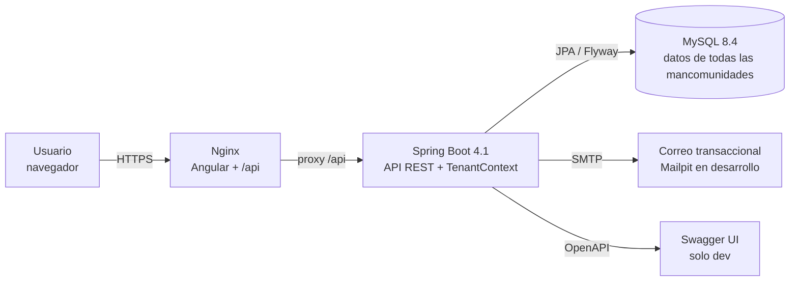
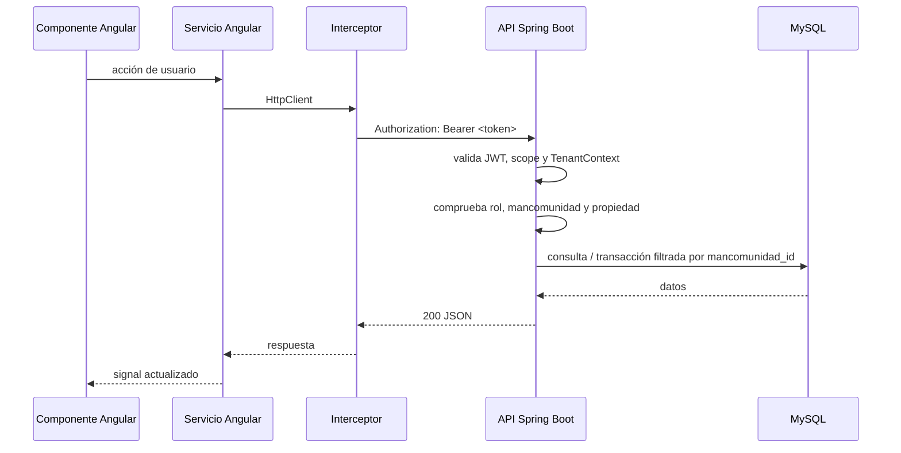

# Arquitectura general

## 1. Estilo

**Monolito modular** con API REST y SPA:

- Un único backend Spring Boot, organizado por funcionalidades.
- Un único frontend Angular, con rutas lazy y componentes standalone.
- Una base de datos MySQL compartida por todas las mancomunidades, con aislamiento lógico por `mancomunidad_id`.
- Sin microservicios, colas ni caché distribuida en la v1.

> [!tip] Por qué
> El dominio es pequeño y cohesionado. Un monolito modular es más sencillo de desarrollar, probar y desplegar, y permite extraer módulos más adelante si hiciera falta.

## 2. Vista de contenedores



En desarrollo, Angular corre en `http://localhost:4200` y Spring Boot en `http://localhost:8080`; el proxy de Angular evita CORS. La mancomunidad no cambia la instancia ni la base de datos: es una frontera lógica que viaja en el token y se aplica en cada consulta.

## 3. Estructura del repositorio

```text
SpringbootAngular/
├── docs/                    # vault de Obsidian
├── backend/                 # Spring Boot
│   ├── pom.xml
│   ├── mvnw
│   └── src/
├── frontend/                # Angular
│   ├── package.json
│   └── src/
├── compose.yaml             # MySQL 8.4
├── .env.example
├── .gitignore
└── README.md
```

## 4. Backend: paquetes por funcionalidad

```text
com.mancomunidad
├── MancomunidadApplication.java
├── config/                  # seguridad, CORS, OpenAPI, auditoría
├── common/                  # errores, paginación, utilidades
│   ├── error/
│   ├── pagination/
│   └── security/
├── tenant/                  # TenantContext, filtro y resolución de mancomunidad
├── auth/                    # login, selección, refresh, tokens y recuperación
├── correo/                  # plantillas y envío SMTP
├── plataforma/              # panel SUPERADMIN y soporte de cuentas
├── mancomunidad/            # entidad y administración de tenants
├── usuario/                 # identidad global y pertenencias
├── centro/
├── asignatura/
├── alumno/
├── instrumento/
├── matricula/
├── horario/
├── solicitud/
├── docencia/
│   ├── sesion/
│   ├── asistencia/
│   ├── observacion/
│   └── preparacion/
└── shared/                  # value objects y excepciones de dominio
```

Cada módulo contiene:

```text
usuario/
├── UsuarioController.java
├── UsuarioService.java
├── UsuarioRepository.java
├── Usuario.java
├── dto/
│   ├── UsuarioRequest.java
│   └── UsuarioResponse.java
└── mapper/
    └── UsuarioMapper.java
```

Reglas:

- Los controllers no contienen lógica de negocio.
- Los services concentran reglas y transacciones.
- Los repositories solo acceden a datos.
- Las entidades JPA no se exponen en la API; se usan DTOs.
- Las validaciones de entrada van en los DTOs con Bean Validation.

## 5. Frontend: estructura

```text
src/app/
├── core/
│   ├── auth/                # AuthService, token storage, mancomunidad activa
│   ├── http/                # interceptores
│   ├── guards/              # authGuard, roleGuard, tenantGuard
│   └── models/              # interfaces compartidas
├── shared/
│   ├── components/          # tabla, diálogo, paginador…
│   ├── directives/
│   └── pipes/
├── layout/                  # shell, sidebar, header con selector de mancomunidad
├── features/
│   ├── auth/                # login, selección, recuperación y cambio de contraseña
│   ├── plataforma/          # solo SUPERADMIN: mancomunidades y cuentas
│   ├── admin/
│   │   ├── usuarios/
│   │   ├── centros/
│   │   ├── asignaturas/
│   │   ├── alumnos/
│   │   ├── instrumentos/
│   │   ├── horarios/
│   │   ├── solicitudes/
│   │   └── consultas/
│   └── profesor/
│       ├── horario/
│       ├── asignaturas/
│       ├── alumnos/
│       ├── observaciones/
│       ├── asistencia/
│       ├── preparaciones/
│       └── solicitudes/
├── app.routes.ts
└── app.config.ts
```

- Componentes **standalone**.
- Estado local con **signals**; servicios con `HttpClient`.
- Formularios reactivos y tipados.
- `ChangeDetectionStrategy.OnPush` por defecto.
- Guards para autenticación y rol.
- Interceptor para añadir el access token y refrescar en `401` (una sola vez).

## 6. Flujo de una petición



## 7. Entornos

| Entorno | Frontend | Backend | Base de datos | Correo |
| --- | --- | --- | --- | --- |
| Desarrollo | `localhost:4200` | `localhost:8080` | MySQL en Docker, `localhost:3306` | Mailpit, `localhost:8025` |
| Staging | Nginx (contenedor) | Spring Boot en contenedor | MySQL en contenedor con volumen | SMTP real del proveedor (dominio de pruebas) |
| Producción | Nginx | Spring Boot en contenedor | MySQL gestionado o contenedor con volumen | SMTP del proveedor |

### 7.1 Staging

- **Permanente**, no efímero: un único entorno de staging vive de forma continua y se redepliega en cada merge a `main`. Los entornos efímeros por PR se descartan por coste y por la necesidad de datos realistas.
- **Datos:** semilla estable con dos mancomunidades de prueba (una de tipo `MUSICA` y otra de tipo `IDIOMAS`), cursos escolares, centros, profesores, alumnos e instrumentos, más un conjunto de datos anonimizados importados desde producción cuando se necesite reproducir un incidente. Nunca se usan datos personales reales sin anonimizar.
- **Aislamiento:** staging no comparte base de datos ni secretos con producción. Su KEK de copias es propia.
- **Acceso:** solo el equipo de desarrollo y operación. No se entrega a clientes ni a mancomunidades. El login de staging usa cuentas de prueba documentadas en el repositorio privado de operación.
- **Despliegue:** automático desde `main` tras CI verde; las migraciones Flyway se aplican antes de arrancar.
- **Pruebas:** la prueba trimestral de restauración y el smoke test de asistencia se ejecutan aquí.

### 7.2 Accesos y secretos

- Los accesos a cada entorno se gestionan por roles del proveedor de infraestructura; no se comparten credenciales entre entornos.
- Las claves JWT, la clave de copias y las credenciales SMTP son distintas en `dev`, `staging` y `prod`.
- Un administrador de mancomunidad nunca tiene acceso a la infraestructura ni a las copias; solo a su panel.

## 8. Manejo de errores

- Backend: `@RestControllerAdvice` que devuelve `application/problem+json` (RFC 7807).
- Frontend: interceptor que transforma errores en mensajes claros y muestra `MatSnackBar`.
- Errores de validación: mapa `campo → mensaje`.
- Nunca se devuelven trazas internas al cliente.

## 9. Estrategia de pruebas

| Nivel | Backend | Frontend |
| --- | --- | --- |
| Unitario | Servicios y reglas de negocio con JUnit + Mockito. | Servicios y pipes con Vitest/Jasmine. |
| Integración | `@SpringBootTest` + Testcontainers MySQL, con dos mancomunidades. | Componentes con `HttpTestingController`. |
| E2E | Opcional en Fase 10 (Playwright). | Opcional. |

> [!important] Pruebas de aislamiento
> Cada módulo de negocio debe demostrar que un usuario de la mancomunidad A no puede leer ni escribir datos de B, incluso cambiando IDs en la URL. Es un criterio de aceptación, no un extra.

## 10. Decisiones abiertas

- ~~¿Se usa `@Version` para bloqueo optimista en franjas y alumnos?~~ **Resuelto: sí, en toda entidad mutable con `updated_at`; la API envía `version` y responde `409` si no coincide.**
- ¿Se separa el frontend en un repositorio? No: monorepo.
- ¿Se añade un módulo de notificaciones internas? Fuera de la v1.
- ~~¿Se refuerzan todas las FKs con `(mancomunidad_id, id)` o solo las relaciones más expuestas?~~ **Resuelto: no; FKs simples y validación de la misma mancomunidad en el servicio, con tests de aislamiento.**
- ¿Se permite impersonación de soporte desde plataforma? No en la v1: el soporte administra cuentas, no datos académicos.

## 11. Integración continua y despliegue

El repositorio es un monorepo (`backend/`, `frontend/`, `docs/`, `compose.yaml`). El flujo de trabajo y el despliegue se automatizan con **GitHub Actions** sobre la rama `main` y las etiquetas `v*`.

### 11.1 Pipeline de integración (`ci.yml`)

Se dispara en cada `push` y `pull request` a `main`. Todos los pasos deben pasar para que el PR sea fusionable.

1. **Backend** — `./mvnw -q verify`:
   - Compilación con Java 21.
   - Tests unitarios de servicios y reglas de negocio.
   - Tests de integración con `@SpringBootTest` + **Testcontainers MySQL**, incluyendo las pruebas de aislamiento con dos mancomunidades.
   - Validación de migraciones Flyway: se aplican sobre una base efímera y se comprueba que no quedan pendientes.
2. **Frontend** — `npm ci` y después, en paralelo cuando sea posible:
   - `npm run lint` (ESLint + reglas de Angular).
   - `npm test -- --watch=false` (Vitest/Jasmine).
   - `npm run build` (producción, con `budgets` de tamaño).
3. **Verificación de estilo** — Checkstyle/Spotless en el backend y Prettier en el frontend, para que el formato no dependa del editor.

El pipeline no publica artefactos salvo los informes de tests; su objetivo es bloquear regresiones. Tiempo objetivo: menos de 10 minutos; si se supera, se paraleliza por módulo.

### 11.2 Pipeline de despliegue (`cd.yml`)

Se dispara manualmente o al crear una etiqueta `vX.Y.Z`. Construye y publica las imágenes Docker del backend y del frontend en el registro (GHCR). El despliegue automático al servidor con Docker Compose se conectará cuando exista la infraestructura de staging/producción (Fase 10); hasta entonces el workflow solo publica imágenes versionadas por etiqueta y SHA.

- Las **migraciones Flyway** se aplican antes de arrancar la nueva versión.
- El despliegue es de tipo **recreate** con ventana de mantenimiento corta; si la plataforma lo permite, se puede pasar a blue/green.
- Tras el arranque se ejecuta un **health check** (`/actuator/health`) y, si falla, se revierte a la imagen anterior.
- El **rollback** es un redeploy de la imagen anterior. Por eso las migraciones deben ser retrocompatibles; si una no lo es, se añade una migración de reversión en el mismo cambio.

> [!note] Estado en la Fase 1
> `ci.yml` y `cd.yml` ya existen. `ci.yml` valida backend, frontend, migraciones Flyway y la construcción de ambas imágenes; `cd.yml` publica las imágenes en GHCR al crear una etiqueta `v*`. El paso de despliegue remoto queda pendiente de la infraestructura.

### 11.3 Ramas, etiquetas y entornos

| Elemento | Regla |
| --- | --- |
| `main` | Protegida; solo se fusiona con PR y CI verde. |
| Ramas de trabajo | `feat/…`, `fix/…`, `docs/…`, con vida corta. |
| Etiquetas | `vX.Y.Z` para releases; disparan el despliegue a producción. |
| `dev` | Entorno local: MySQL en Docker, Mailpit, Swagger UI activo. |
| `staging` | Se despliega desde `main` automáticamente; datos de prueba y SMTP real. |
| `prod` | Solo por etiqueta o acción manual; sin Swagger UI ni datos de demo. |

### 11.4 Secretos y artefactos

- Las credenciales SMTP, las claves JWT (`APP_JWT_PRIVATE_KEY_PATH`, `APP_JWT_PUBLIC_KEY_PATH`), `APP_PURGE_SECRET` y la clave de copia viven en **GitHub Secrets** y en el gestor de secretos del servidor. Nunca en el repositorio, en la imagen ni en los logs.
- El pipeline **no imprime** secretos: se inyectan como variables de entorno o ficheros montados en el paso de despliegue.
- Artefactos publicados: JAR del backend, bundle del frontend e imágenes Docker versionadas por commit y etiqueta.
- Las copias de seguridad y el script de exportación por mancomunidad se ejecutan en el servidor, no en el pipeline.

### 11.5 Reglas de compatibilidad

- Una migración nueva debe aplicarse sobre una base que ya tenga la versión anterior; no se reescribe historia de Flyway.
- El backend nuevo debe funcionar con el esquema anterior durante el despliegue, para no romper el rollback.
- Si un cambio requiere datos de inicialización, se hace en una migración versionada, no en un script suelto.

## 12. Presupuesto de rendimiento

Valores de referencia para dimensionar y probar (detalle en [[Requisitos no funcionales]] REN-06 a REN-10):

- **50 usuarios concurrentes por mancomunidad**, 500 en toda la plataforma.
- **Latencia p95 < 500 ms** en lecturas y **< 1 s** en escrituras, medida desde el navegador.
- **Página por defecto de 20, máximo 100**; sin consultas sin paginar salvo catálogos pequeños.
- **Volumen típico:** 500 alumnos, 50 profesores y 100 asignaturas por mancomunidad; el diseño no debe degradarse hasta 5.000 alumnos y 500 profesores.
- **Bundle inicial del frontend < 500 kB** comprimidos, con carga por ruta.
- Las pruebas de carga se ejecutarán en staging antes de cada release mayor.

[[Stack tecnológico]] · [[Multi-tenencia]] · [[Seguridad y autenticación]] · [[API REST]] · [[Convenciones]] · [[Requisitos no funcionales]] · [[Copias de seguridad y exportación]] · [[Roadmap]] · [[ADR-001 - Stack tecnológico]] · [[ADR-009 - Multi-tenant con mancomunidad e identidad global]] · [[ADR-011 - Recuperación de contraseña y correo transaccional]] · [[ADR-012 - Soporte de cuentas del superadministrador]]
