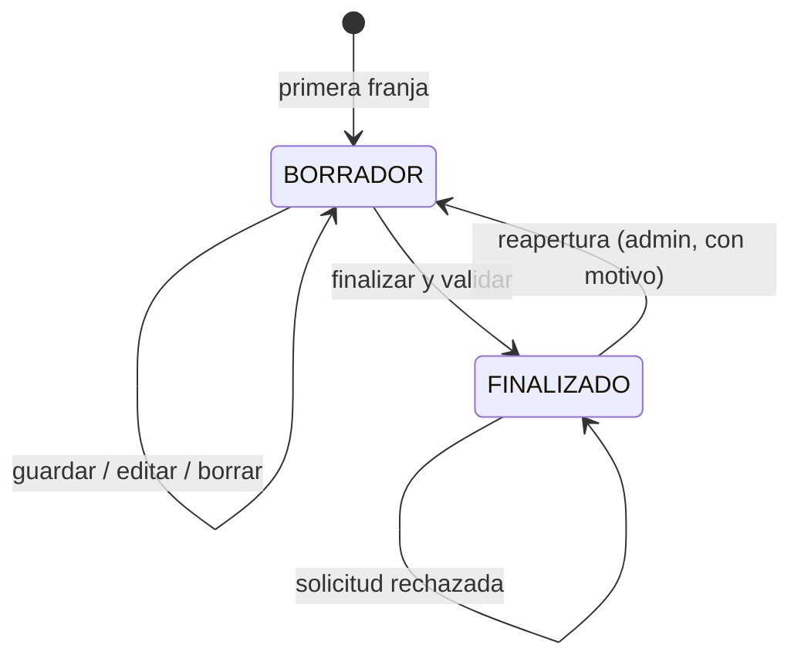

# ADR-004 — Horario gestionado por el profesor con borrador y finalización

> [!warning] Sustituida parcialmente por [[ADR-016 - Horario editable por profesor y administrador]]
> La decisión de que **solo el profesor** edita el horario queda sustituida: desde 2026-11-02, el profesor titular y cualquier administrador de la mancomunidad pueden crear, editar y finalizar horarios en `BORRADOR`. El resto de este ADR —borrador, finalización, bloqueo, solicitudes y reapertura auditada— sigue vigente.

## Contexto

El requisito indica que el profesor crea su propio horario de lunes a domingo. La planificación real no se hace de golpe: el profesor va guardando franjas a medida que las tiene claras y necesita un momento explícito en el que da el horario por cerrado. La administración quiere supervisar los horarios y tener constancia de los cambios posteriores, pero no editarlos.

## Decisión

- Cada profesor tiene **un [[Horario del profesor]] por curso escolar**, con estado `BORRADOR` o `FINALIZADO`.
- El **profesor** crea, edita y elimina sus franjas y puede **guardar de forma parcial** mientras el horario está en `BORRADOR`.
- Cuando el horario está completo, el profesor lo **finaliza**. La operación valida solapamientos, asignaturas y que exista al menos una franja.
- Tras la finalización se **bloquea la edición directa**. Cualquier cambio se canaliza mediante una [[Solicitud de cambio de horario]], que deja registro y resuelve la administración.
- El **administrador** consulta todos los horarios, ve el estado y resuelve solicitudes; **no edita franjas directamente**.
- El administrador puede **reabrir un horario `FINALIZADO`** para que el profesor lo corrija. La reapertura exige motivo, queda auditada en [[Historial de horario]], no altera las franjas y cancela las solicitudes pendientes.
- Toda la validación (solapamientos, horas, asignatura asignada) se ejecuta en el backend dentro de una transacción.

## Flujo

## Consecuencias

### Positivas

- El profesor planifica a su ritmo sin perder lo avanzado.
- La finalización marca un punto de control claro y comprensible.
- Los cambios posteriores quedan registrados como solicitudes con motivo, autor y resolución.
- La administración supervisa sin sustituir al profesor.
- Las reglas de conflicto quedan centralizadas y son testeables.

### Negativas / compromisos

- Hay que gestionar el ciclo de vida del horario y su estado en backend y frontend.
- El administrador no puede corregir franjas de urgencia; reabre el horario o aprueba una solicitud.
- La reapertura añade un paso administrativo y obliga a volver a finalizar; hay que dejar claro en la interfaz que el horario ha cambiado de estado.
- La interfaz de rejilla semanal con guardado parcial es más compleja que un formulario clásico.
- La reapertura debe conservar la traza completa y cancelar solicitudes pendientes sin dejarlas huérfanas.

## Alternativas consideradas

| Alternativa | Motivo de descarte |
| --- | --- |
| El administrador asigna todo el horario | Contradice el requisito de que el profesor crea el suyo. |
| Edición libre permanente sin estados | No habría forma de saber cuándo el horario está cerrado ni de auditar cambios. |
| Aprobación previa de cada franja | Ralentiza la planificación y añade burocracia innecesaria. |
| Guardar solo al final, sin borrador | El profesor perdería el trabajo si no termina en una sesión. |

## Relacionado

[[Horario del profesor]] · [[Franja horaria]] · [[Solicitud de cambio de horario]] · [[Historial de horario]] · [[Roles y permisos]] · [[Requisitos funcionales]] · [[ADR-007 - Historial de cambios de asistencia]] · [[ADR-016 - Horario editable por profesor y administrador]]
