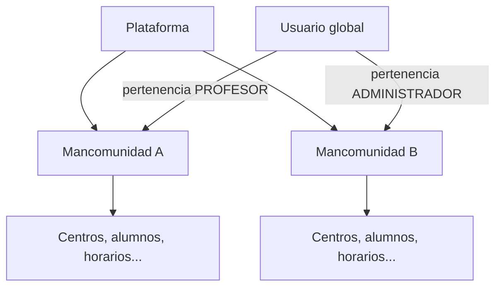
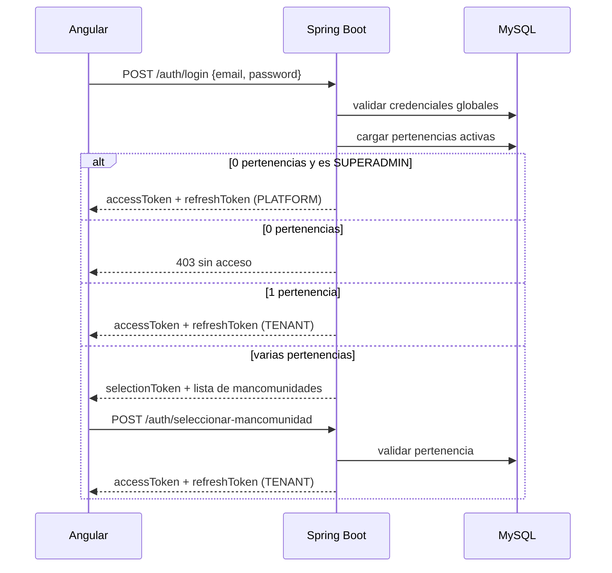

# Multi-tenencia

## 1. Idea general

El sistema se diseña para una mancomunidad, pero preparado para alojar varias. Cada **mancomunidad es un tenant**: una frontera de datos, configuración y permisos.

La estrategia elegida es **una base de datos compartida con `mancomunidad_id`** e **identidad global de usuario**. La decisión y sus alternativas están en [[ADR-009 - Multi-tenant con mancomunidad e identidad global]].

## 2. Qué es global y qué pertenece a una mancomunidad

| Ámbito | Datos |
| --- | --- |
| **Global** | `usuario`, credenciales, `refresh_token` de sesión, `token_recuperacion_password`, `mancomunidad`, `usuario_mancomunidad`, auditoría de plataforma. |
| **Por mancomunidad** | Centros, cursos escolares, días no lectivos, asignaturas, alumnos, instrumentos, matrículas, horarios, historial de horario, franjas, sustituciones, sesiones, asistencias, historial de asistencia, resumen de asistencia, observaciones y preparaciones. |

Regla práctica:

> Toda tabla con datos académicos o personales de una mancomunidad lleva `mancomunidad_id`, aunque pueda deducirse por una relación. Se prefiere la redundancia controlada a una consulta que pueda mezclar tenants.

## 3. Identidad y roles

- **`Usuario`** es la identidad global: email único, contraseña y estado de la cuenta.
- **`UsuarioMancomunidad`** es la pertenencia: rol y estado dentro de una mancomunidad.
- Roles de mancomunidad: `PROFESOR` y `ADMINISTRADOR`.
- Rol de plataforma: `SUPERADMIN`, con dos planos: mancomunidades y **cuentas**. El plano académico queda fuera.

Un usuario puede ser:

- profesor en A y administrador en B;
- administrador de plataforma y, además, miembro de una mancomunidad;
- miembro de una sola mancomunidad y entrar directamente;
- miembro de varias y elegir en cada inicio de sesión.

El rol **nunca es global**. Un `ADMINISTRADOR` de A no puede ver ni administrar B.

## 4. Inicio de sesión y selección de mancomunidad

Detalles:

- El **token de selección** es de corta vida (unos 5 minutos) y solo sirve para elegir mancomunidad.
- El **access token** incluye `usuarioId`, `mancomunidadId`, `rol` y `scope`.
- El **refresh token** está ligado a la sesión y a la mancomunidad activa.
- Cambiar de mancomunidad valida la pertenencia y rota los tokens; no hace falta volver a escribir la contraseña.
- Si la pertenencia se desactiva, el refresh falla y el usuario vuelve a la pantalla de selección o al login.
- Si el usuario es `SUPERADMIN` sin pertenencias, entra en el panel de plataforma.
- Si es `SUPERADMIN` y tiene pertenencias, la pantalla de selección incluye la opción **Plataforma**.

## 5. Panel de plataforma

Solo para `SUPERADMIN`:

- Listar mancomunidades.
- Crear una mancomunidad con nombre, código y primer administrador.
- Sembrar el curso escolar inicial activo.
- Suspender y reactivar mancomunidades.
- Consultar métricas básicas bajo demanda: centros, usuarios y alumnos activos. Sin tiempo real.
- Auditar altas, suspensiones y reactivaciones.
- **Soporte de cuentas**: buscar usuarios globales, resetear contraseñas, activar o desactivar cuentas y pertenencias y cambiar roles, con motivo y auditoría.

El panel **no muestra datos académicos** de las mancomunidades. El soporte de cuentas tampoco: administra identidades y pertenencias, no alumnos, horarios ni asistencias. Si en el futuro se necesita soporte técnico con acceso temporal, se hará con una impersonación explícita, auditada y limitada en el tiempo, no con acceso permanente ([[ADR-012 - Soporte de cuentas del superadministrador]]).

## 6. Aislamiento: reglas no negociables

1. El `mancomunidadId` se obtiene del token, nunca de un parámetro manipulable.
2. Existe un `TenantContext` por petición, establecido tras validar el token y la pertenencia.
3. Todos los repositorios y `Specification` filtran por la mancomunidad activa.
4. Las claves únicas incluyen `mancomunidad_id`.
5. Las relaciones entre filas deben pertenecer a la misma mancomunidad.
6. Un recurso de otra mancomunidad responde `404`, no `403`, para no revelar su existencia.
7. Los tests de integración se ejecutan con **dos mancomunidades** y comprueban accesos cruzados.
8. Los trabajos programados iteran explícitamente por mancomunidad; no hay consultas «globales» accidentales.
9. Las exportaciones y backups lógicos se filtran por mancomunidad.
10. Los trabajos de generación de sesiones y de purga por retención se ejecutan **por mancomunidad**, nunca en una consulta global.

> [!warning] Límite aceptado: profesor compartido
> Un mismo usuario puede tener pertenencia activa en varias mancomunidades. El horario se valida solo dentro de la mancomunidad activa, así que **no se detectan solapamientos del mismo profesor entre tenants** ([[ADR-022 - Conflictos de profesor entre mancomunidades]]). Los conflictos de alumno sí se validan dentro del tenant.

> [!danger] MySQL no tiene row-level security
> El aislamiento es responsabilidad de la aplicación. Una consulta sin filtro puede filtrar datos entre mancomunidades. Por eso las pruebas de aislamiento son obligatorias en cada fase que toque datos de negocio.

> [!note] Implementación provisional en la Fase 1
> Mientras no existe autenticación, los perfiles `dev` y `test` resuelven el tenant con la cabecera `X-Mancomunidad-Id`, activa solo con `app.tenant.header-enabled=true`. `GET /api/v1/tenant/actual` permite comprobar la resolución. En producción está desactivado y la Fase 2 lo sustituye por el JWT.

## 7. Qué implica en el dominio

- `Mancomunidad` es la raíz de configuración.
- `Centro`, `CursoEscolar`, `Instrumento` y `UsuarioMancomunidad` cuelgan de ella.
- `Asignatura`, `Alumno`, `Matrícula`, `Horario del profesor`, `Historial de horario`, `Franja horaria`, `Sustitución`, `Sesión de clase`, `Asistencia`, `Historial de asistencia`, `Resumen de asistencia`, `Día no lectivo`, `Observación`, `Preparación de clase` y `Solicitud de cambio de horario` llevan `mancomunidad_id`.
- El **alumno es local al tenant**: no existe identidad global de menores ni deduplicación entre mancomunidades. La misma persona en dos tenants son dos registros independientes y no se puede buscar desde la plataforma ([[ADR-009 - Multi-tenant con mancomunidad e identidad global]]).
- La **sustitución** se valida contra el horario y las demás sustituciones de la misma mancomunidad; no se comprueban disponibilidades de un profesor compartido en otro tenant.
- El curso activo es único **por mancomunidad**.
- El catálogo de instrumentos es **por mancomunidad**.
- El calendario de días no lectivos y el resumen anonimizado de asistencia son **por mancomunidad**.
- Un profesor solo puede impartir asignaturas de mancomunidades en las que tiene pertenencia activa como `PROFESOR`.

## 8. Fases de implementación

| Fase | Alcance multi-tenant |
| --- | --- |
| 0 | Modelo, ADR y decisiones. |
| 1 | Tablas `mancomunidad` y `usuario_mancomunidad`, `mancomunidad_id` y siembra de una mancomunidad. |
| 2 | Login con pertenencias, token de selección, cambio de mancomunidad y cambio obligatorio de contraseña temporal. |
| 3 | Gestión de usuarios y pertenencias por el administrador de la mancomunidad y recuperación autoservicio por correo. |
| 11 | Panel de plataforma: crear, suspender y reactivar mancomunidades, y soporte de cuentas con auditoría. |

## 9. Riesgos

- **Fuga entre tenants** por una consulta sin filtro. Mitigación: contexto obligatorio, revisiones y tests con dos mancomunidades.
- **Complejidad del login**: más estados y tokens. Mitigación: flujo explícito y pruebas de 0/1/varias pertenencias.
- **Roles obsoletos en tokens**: un cambio de rol tarda como máximo lo que dura el access token. Mitigación: access token corto y revocación de refresh.
- **Crecimiento de la tabla global de usuarios**: se indexa por email y se mantiene separada de los datos académicos.
- **Soporte técnico**: el acceso de plataforma no debe convertirse en acceso académico permanente. El plano de cuentas está separado y auditado; la impersonación queda fuera de la v1.

## Relacionado

[[ADR-009 - Multi-tenant con mancomunidad e identidad global]] · [[ADR-011 - Recuperación de contraseña y correo transaccional]] · [[ADR-012 - Soporte de cuentas del superadministrador]] · [[ADR-021 - Validación de conflictos de alumno]] · [[ADR-022 - Conflictos de profesor entre mancomunidades]] · [[ADR-023 - Copia de horario al curso siguiente]] · [[ADR-024 - Cierre y reapertura de curso escolar]] · [[ADR-025 - Sustituciones y cambio de titular]] · [[ADR-026 - Baja de alumno a mitad de curso]] · [[Mancomunidad]] · [[UsuarioMancomunidad]] · [[Usuario]] · [[Alumno]] · [[Sustitución]] · [[Seguridad y autenticación]] · [[Roles y permisos]] · [[Modelo de datos]] · [[Historial de horario]] · [[API REST]]
