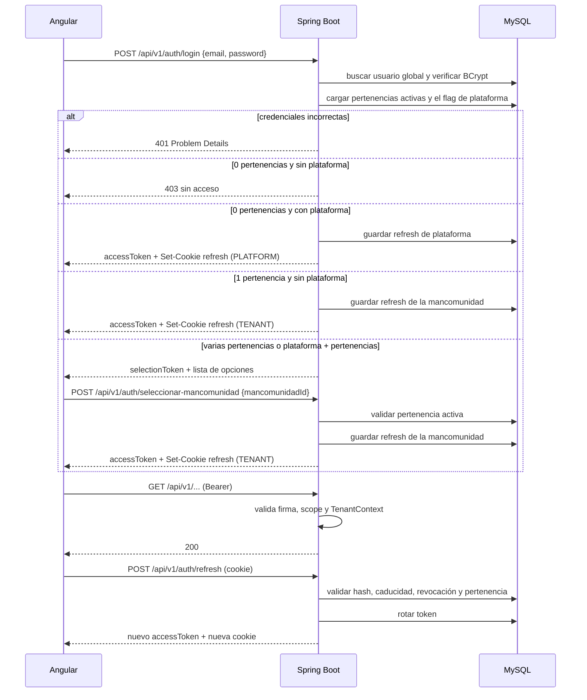
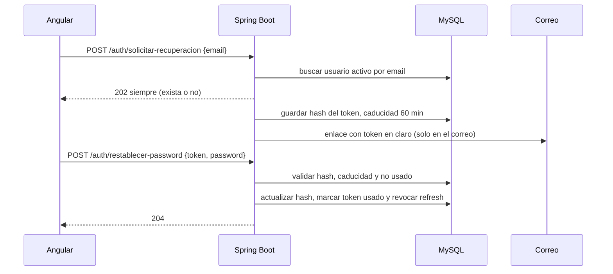

# Seguridad y autenticación

## 1. Modelo

- Autenticación **stateless** con JWT para las peticiones a la API.
- **Identidad global**: el email y la contraseña identifican a una persona, no a una mancomunidad.
- **Roles por mancomunidad**: `PROFESOR` o `ADMINISTRADOR` viven en `UsuarioMancomunidad`; `SUPERADMIN` es un flag de plataforma.
- **Access token** de 15 minutos, enviado en `Authorization: Bearer`, con `usuarioId`, `mancomunidadId`, `rol`, `scope`, `tv` y `tvm`.
- **Refresh token** de 7 días, en cookie `HttpOnly`, `Secure` (producción) y `SameSite=Strict`, ligado a la mancomunidad activa y a una **familia** de sesión.
- **Token de selección** de 5 minutos, solo para elegir mancomunidad cuando el usuario tiene varias pertenencias.
- **Token de recuperación** de 60 minutos como máximo, de un solo uso y guardado hasheado, para restablecer la contraseña.
- **Verificación de email** de 24 horas, de un solo uso y guardada hasheada; habilita la recuperación autoservicio ([[ADR-028 - Verificación y cambio de email]]).
- El usuario tiene un flag **`debe_cambiar_password`**: mientras esté activo, el login no emite tokens de negocio y solo permite cambiar la contraseña o cerrar sesión.
- El refresh token se guarda **hasheado** en base de datos y **rota** en cada uso dentro de la misma familia.
- Los access tokens se firman con **RS256** e incluyen `kid`; el JWKS publica solo las claves públicas ([[ADR-029 - Claves JWT, rotación y secretos]]).
- `usuario.token_version` y `usuario_mancomunidad.token_version` permiten revocar access tokens en curso en menos de 60 segundos.
- Cada cuenta puede tener como máximo **5 familias de refresh activas** y puede cerrarlas todas con la contraseña actual ([[ADR-031 - Límite de sesiones concurrentes y cierre global]]).
- Autorización por mancomunidad + rol + propiedad del recurso.
- **MFA fuera de la v1**, incluida la cuenta de plataforma; el riesgo se acepta con controles compensatorios y revisión antes de producción ([[ADR-027 - MFA y riesgo aceptado del superadministrador]]).

## 2. Flujo de login, selección y refresh

Reglas del flujo:

- El **token de selección** no da acceso a datos; solo puede canjearse por una mancomunidad de la lista.
- Si el usuario solo tiene una pertenencia, no se muestra selector.
- Un `SUPERADMIN` sin pertenencias entra directamente al panel de plataforma con `scope = PLATFORM`.
- Un `SUPERADMIN` con pertenencias ve la opción **Plataforma** junto a sus mancomunidades.
- El cambio de mancomunidad (`POST /auth/cambiar-mancomunidad`) valida la pertenencia y rota los tokens; no pide contraseña.
- Si la pertenencia se desactiva, el refresh falla y el usuario vuelve al selector o al login.
- Si `debe_cambiar_password` está activo, el login devuelve un estado limitado con un token de cambio; no se emiten tokens de negocio hasta que la contraseña se actualice.
- La cuenta global desactivada y la mancomunidad suspendida bloquean tanto el login como el refresh.
- El cliente Angular hace **refresh single-flight**: si hay una renovación en curso, las peticiones esperan al mismo resultado y no lanzan refresh en paralelo ([[ADR-030 - Detección de reutilización de refresh tokens]]).
- El filtro JWT compara `tv`/`tvm` con la base de datos mediante una caché de 60 segundos; una cuenta o pertenencia revocada deja de aceptar access tokens sin esperar a que caduquen.
- El email sin verificar **no bloquea el login**, pero deshabilita la recuperación autoservicio ([[ADR-028 - Verificación y cambio de email]]).
- La mancomunidad activa **nunca** se toma del cuerpo de una petición de negocio.

## 3. Almacenamiento en Angular

- El **access token vive en memoria** (signal dentro de `AuthService`), no en `localStorage`.
- El **token de selección** también vive en memoria y se descarta al elegir mancomunidad o al caducar.
- El **refresh token no es accesible desde JavaScript** (cookie `HttpOnly`).
- La mancomunidad activa se guarda como parte del estado de sesión, no como fuente de permisos: el backend siempre la toma del token.
- Al recargar la página, se llama a `/auth/refresh` para recuperar un access token.
- Al cerrar sesión, se revoca la familia de refresh y se limpia el estado.
- El interceptor de refresh es **single-flight** y reintenta una sola vez la petición original; si el refresh responde `401`, limpia la sesión y vuelve al login.
- La lista de sesiones (`GET /auth/sesiones`) muestra IP, `userAgent`, fecha de creación y último uso; **nunca** devuelve tokens.
- «Cerrar todas las sesiones» (`POST /auth/logout-all`) exige la contraseña actual y limpia también el estado local.

> [!warning] Por qué no guardar el access token en localStorage
> Cualquier XSS podría leerlo. En memoria se pierde al recargar, pero el refresh cookie permite recuperar la sesión de forma controlada.

## 4. Tabla `refresh_token`

| Campo | Tipo | Notas |
| --- | --- | --- |
| `id` | BIGINT | PK. |
| `usuario_id` | BIGINT | FK a usuario. |
| `mancomunidad_id` | BIGINT | FK a mancomunidad; obligatorio si `scope = TENANT`, nulo si `PLATFORM`. |
| `scope` | VARCHAR(20) | `TENANT` o `PLATFORM`. |
| `familia_id` | CHAR(36) | UUID de la sesión; todas las rotaciones comparten familia. |
| `token_hash` | CHAR(64) | SHA-256 del token; nunca el token en claro. |
| `expires_at` | DATETIME | 7 días desde la emisión. |
| `revocado` | BOOLEAN | `true` al cerrar sesión, rotar o revocar la familia. |
| `revocado_at` | DATETIME | Fecha de la revocación. |
| `motivo_revocacion` | VARCHAR(30) | `LOGOUT`, `ROTACION`, `REUTILIZACION`, `CAMBIO_PASSWORD`, `CAMBIO_EMAIL`, `DESACTIVACION`, `CAMBIO_ROL` o `LIMITE_SESIONES`. |
| `reemplazado_por` | BIGINT | FK al siguiente token, si se rotó. |
| `ultimo_uso_at` | DATETIME | Se actualiza en cada rotación; ordena la lista y decide el desalojo. |
| `ip` | VARCHAR(45) | IPv4 o IPv6 de la sesión. |
| `user_agent` | VARCHAR(255) | Se muestra en la lista de sesiones del usuario. |
| `created_at` | DATETIME | Auditoría. |

Un refresh de `TENANT` no puede reutilizarse para otra mancomunidad. Al desactivar una pertenencia o cambiar su rol se revocan los refresh tokens de ese usuario para esa mancomunidad. El logout y las revocaciones por seguridad cierran la **familia completa**, no solo el token actual ([[ADR-030 - Detección de reutilización de refresh tokens]]).

> [!warning] Reutilización de un refresh ya rotado
> Si llega un token con `reemplazado_por`, se revoca toda la familia, se incrementa `usuario.token_version`, se registra `REUTILIZACION_REFRESH` en `evento_seguridad` y se responde `401`. No hay periodo de gracia; por eso el cliente hace refresh single-flight.

## 5. Contraseñas

### 5.1 Política

- Hash con **BCrypt coste 12** (o Argon2id si se configura).
- Longitud mínima 8, máxima 72; al menos una letra y un número. Las cuentas con `admin_plataforma` exigen **mínimo 12** ([[ADR-027 - MFA y riesgo aceptado del superadministrador]]).
- No se permite reutilizar la contraseña actual.
- Todo cambio o restablecimiento revoca los refresh tokens del usuario y se registra sin guardar la contraseña ni el token.
- El bloqueo por intentos fallidos se detalla en 5.5.

### 5.2 Cambio obligatorio

- El campo `debe_cambiar_password` se activa al crear una cuenta con contraseña temporal y al resetearla un administrador o el soporte.
- Mientras esté activo, el login devuelve `debeCambiarPassword: true` y un token limitado que solo permite `PATCH /auth/password` y `POST /auth/logout`.
- El cambio exige la contraseña actual y aplica la política; al guardarlo se desactiva el flag, se revocan los refresh tokens y se permite un login normal.
- La contraseña temporal caduca a las **24 horas**; si llega caducada, se rechaza el login y hay que pedir otra o usar la recuperación.

### 5.3 Recuperación autoservicio

Reglas:

- La respuesta es siempre la misma y `202`; no se confirma si el email existe.
- Solo se envía el enlace si la cuenta está activa y su email está **verificado**; si no, la respuesta sigue siendo `202` y no se envía nada ([[ADR-028 - Verificación y cambio de email]]).
- Límite por IP y por cuenta: 3 peticiones por hora y email, 10 por hora y IP, con respuesta `429` y `Retry-After` ([[ADR-032 - Rate limiting de extremos sensibles]]).
- El token es aleatorio, se guarda como SHA-256, caduca a los 60 minutos y se invalida al usarse, al pedir otro o al cambiar la contraseña.
- El enlace se construye con la URL pública configurada, no con la cabecera `Host`.
- Si el correo falla, la petición sigue respondiendo `202`; el fallo se registra para operación.
- No se envía nunca una contraseña en claro por correo.

### 5.4 Reset por administrador o soporte

- El administrador de la mancomunidad puede resetear la contraseña de un usuario de su tenant; el `SUPERADMIN`, la de cualquier cuenta ([[ADR-012 - Soporte de cuentas del superadministrador]]).
- El reset genera una contraseña temporal **en el servidor**, activa `debe_cambiar_password` y revoca todas las sesiones e incrementa `token_version`.
- La contraseña temporal no se devuelve en la API: se entrega al titular fuera de banda. El actor no la elige, no la recibe y no puede recuperarla; el reset **no es impersonación**.
- La acción exige motivo y queda auditada; el soporte no puede ver ni elegir la contraseña del usuario.
- El reset limpia el bloqueo por intentos fallidos de la cuenta.
- Si el email no está verificado, el reset sigue disponible, pero la recuperación autoservicio no se habilita hasta confirmar la dirección.

### 5.5 Bloqueo por intentos fallidos

- **Cuenta:** 5 fallos en 15 minutos bloquean el login de ese email durante 15 minutos.
- **IP:** 20 fallos en 15 minutos bloquean esa IP durante 15 minutos, para no tumbar un centro con NAT compartido por los fallos de unos pocos.
- Cada intento se guarda en `evento_acceso` (MySQL, append-only); no hay contadores en memoria.
- Un login correcto limpia los fallos de la cuenta, pero no los de la IP.
- Durante el bloqueo, el login responde `429` con un mensaje genérico; no revela si el email existe.
- El bloqueo no revoca las sesiones abiertas: solo impide nuevos inicios de sesión.
- El `SUPERADMIN` puede desbloquear una cuenta antes de que caduque, con motivo y auditoría. El administrador de mancomunidad no tiene desbloqueo directo: el reset de contraseña también limpia el bloqueo.
- El bloqueo de IP no se levanta a mano en la v1; caduca solo.
- Los eventos de acceso se purgan a los 30 días.

Véase [[ADR-014 - Bloqueo temporal de cuentas por intentos fallidos]].

### 5.6 Verificación y cambio de email

- El email es la identidad de login y el único canal de recuperación. Una cuenta nueva nace con `email_verificado = false` y recibe un enlace de verificación de **24 horas**, de un solo uso y guardado como SHA-256.
- Verificar el alta solo marca `email_verificado = true`; no cambia la dirección ni revoca sesiones.
- El cambio de dirección exige la contraseña actual (`PATCH /auth/email`) o una acción de soporte con motivo (`PATCH /plataforma/usuarios/{id}/email`). En ambos casos se envía un enlace a la dirección **nueva** y la anterior sigue siendo el login y el canal de recuperación hasta confirmarla.
- Solo puede haber una verificación pendiente por usuario. Pedir otra invalida la anterior y la dirección nueva debe ser única globalmente; si ya existe, responde `409` sin revelar datos de la otra cuenta.
- Al confirmar el cambio: se actualiza `email`, se marca verificado, se revocan todas las sesiones, se escribe `CAMBIO_EMAIL` en `evento_seguridad` y se avisa a la dirección anterior si estaba verificada.
- El administrador de mancomunidad **no puede cambiar emails**. Puede consultar la dirección y su estado, pero no redirigir la recuperación de un usuario.
- Reenviar la verificación se limita a 3 peticiones por hora y usuario y responde siempre `202`.
- El enlace se construye con la URL pública configurada, nunca con la cabecera `Host`. Véase [[ADR-028 - Verificación y cambio de email]].

## 6. Claves JWT y secretos

- Firma **RS256** (RSA 2048). Se rechazan `alg = none`, HS256 y cualquier algoritmo distinto.
- El encabezado lleva `kid`; el token incluye `iss`, `aud`, `iat`, `nbf`, `exp`, `jti`, `scope`, `usuarioId`, `mancomunidadId` y `rol` cuando aplican, `tv` y `tvm`.
- `GET /.well-known/jwks.json` publica las claves públicas activas. La privada nunca sale del backend ni se incluye en el frontend.
- **Rotación ordinaria cada 90 días:** la clave nueva firma, la anterior solo verifica durante 24 horas y después se retira. **Rotación de emergencia:** se retira del JWKS de inmediato; los clientes renuevan con su refresh opaco.
- `usuario.token_version` y `usuario_mancomunidad.token_version` se incrementan al desactivar la cuenta o la pertenencia, cambiar el rol, cambiar o restablecer la contraseña, detectar reutilización de refresh y cerrar todas las sesiones. El filtro los comprueba con una caché de 60 segundos.
- Los secretos (clave privada, pública, `APP_PURGE_SECRET`, credenciales SMTP) viven en un gestor de secretos o en ficheros montados. Se leen por ruta (`APP_JWT_PRIVATE_KEY_PATH`, `APP_JWT_PUBLIC_KEY_PATH`), no por valor en variables visibles.
- Nunca se guardan en Git, en la imagen, en logs, en el frontend ni en la copia lógica de la base de datos. Véase [[ADR-029 - Claves JWT, rotación y secretos]] y [[Stack tecnológico]].

## 7. Sesiones, reutilización y cierre global

- Cada refresh pertenece a una familia (`familia_id`). La rotación es atómica: el token usado queda revocado con `motivo_revocacion = ROTACION` y `reemplazado_por` apunta al nuevo.
- Si llega un token ya rotado, se revoca la familia completa, se incrementa `token_version`, se registra `REUTILIZACION_REFRESH` y se responde `401`. No hay periodo de gracia.
- Si el token está revocado por logout, cambio de contraseña o email, desactivación, cambio de rol o límite de sesiones, se responde `401` sin volver a revocar.
- Logout revoca la familia actual. `POST /auth/logout-all` exige la contraseña, revoca todas las familias, incrementa `token_version` y borra la cookie.
- Máximo **5 familias activas** por cuenta (configurable con `APP_MAX_SESIONES`); al superarlo se desaloja la más antigua por `ultimo_uso_at`. `GET /auth/sesiones` lista las activas con IP, `userAgent`, creación y último uso, sin tokens.
- No hay revocación individual de una sesión en la v1; se consulta la lista y se cierra todo. El administrador de mancomunidad y el `SUPERADMIN` no listan sesiones de otros: sus acciones de soporte ya revocan las del afectado.
- Las familias revocadas o caducadas se purgan a los 30 días; el evento de seguridad se conserva 1 año. Véanse [[ADR-030 - Detección de reutilización de refresh tokens]] y [[ADR-031 - Límite de sesiones concurrentes y cierre global]].

## 8. Rate limiting

- Tabla `limite_peticion` con clave, ventana fija y contador; incremento atómico con `INSERT ... ON DUPLICATE KEY UPDATE`, sin Redis ni estado en memoria.
- Límites de la v1:

| Ámbito | Clave | Límite |
| --- | --- | --- |
| Recuperación por email | `recovery:email:<sha256>` | 3 por hora |
| Recuperación por IP | `recovery:ip:<ip>` | 10 por hora |
| Reenvío de verificación | `verificacion:usuario:<id>` | 3 por hora |
| Refresh por familia | `refresh:familia:<id>` | 120 por hora |
| Refresh por IP | `refresh:ip:<ip>` | 600 por hora |
| Escrituras autenticadas | `escritura:usuario:<id>` | 60 por minuto y 1.000 por hora |
| Acciones de soporte | `soporte:actor:<id>` | 60 por hora |
| Login | `evento_acceso` (ADR-014) | 5 por cuenta / 20 por IP en 15 min |

- Se consideran escrituras sensibles los `POST`, `PUT`, `PATCH` y `DELETE` autenticados, salvo refresh y logout, que tienen su propio cubo. Las lecturas no se limitan.
- La respuesta es `429` con `application/problem+json`, mensaje genérico, `Retry-After` y, cuando se conoce, `X-RateLimit-Limit`, `X-RateLimit-Remaining` y `X-RateLimit-Reset`. No revela si el email o la cuenta existen.
- Los límites son globales por configuración (`APP_RATE_*`), no por mancomunidad. La tabla se limpia a las 24 horas. Un `429` de rate limiting no altera `evento_acceso` ni se confunde con el bloqueo de login. Véase [[ADR-032 - Rate limiting de extremos sensibles]].

## 9. Idempotencia

- Cabecera **`Idempotency-Key`** (UUID v4 o 16–64 caracteres `[A-Za-z0-9_-]`) obligatoria en las altas y acciones sensibles listadas en [[Convenciones]]; opcional en el resto de escrituras; no admitida en lecturas.
- Tabla `idempotencia` con `usuario_id`, `clave`, `metodo`, `ruta`, `hash_peticion`, estado `EN_CURSO`/`COMPLETADA`, respuesta guardada y caducidad de 24 horas.
- Misma clave, misma ruta y mismo cuerpo: se devuelve la respuesta guardada con `Idempotent-Replay: true` sin repetir el caso de uso. Misma clave con otro cuerpo o ruta: `409 CLAVE_IDEMPOTENCIA_REUTILIZADA`. Estado `EN_CURSO`: `409 OPERACION_EN_CURSO` con `Retry-After: 1`.
- La fila se escribe en la misma transacción que la operación de negocio; si hay rollback, desaparece y el reintento empieza de cero.
- No sustituye a `version` ni a las reglas de negocio: evita duplicar el efecto de un reintento. Véase [[ADR-033 - Idempotencia de peticiones sensibles]].

## 10. MFA y bootstrap de plataforma

- **MFA fuera de la v1** para todos los usuarios, también para `admin_plataforma`. Se acepta el riesgo con controles compensatorios (sin credencial sembrada, contraseña de 12+, límite de sesiones, detección de reutilización, rate limiting, email verificado, rotación de claves, auditoría y alcance mínimo) y revisión/firma antes de producción. La futura MFA será TOTP obligatorio para plataforma ([[ADR-027 - MFA y riesgo aceptado del superadministrador]]).
- El primer `SUPERADMIN` se crea con `--bootstrap-superadmin`, `APP_BOOTSTRAP_ENABLED=true`, email y contraseña por fichero secreto o consola; nunca por argumento ni variable visible. Crea `admin_plataforma = true`, `email_verificado = true` y `debe_cambiar_password = true`, audita `ALTA_SUPERADMIN` y es idempotente si ya hay uno activo.
- No existe endpoint HTTP de bootstrap. La primera mancomunidad y su administrador se crean desde el panel. El comando sirve también de break-glass si se pierde el último superadministrador. Véase [[ADR-034 - Bootstrap del primer superadministrador]].

## 11. Autorización

| Nivel | Mecanismo |
| --- | --- |
| Endpoint | `@PreAuthorize("hasRole('ADMINISTRADOR')")` o reglas en `SecurityFilterChain`, dentro del scope de la mancomunidad. |
| Mancomunidad | `TenantContext` por petición, rellenado desde el token; nunca desde un parámetro del cliente. |
| Propiedad | Comprobación en el servicio: `profesorId == currentUser.id`, matrícula del alumno, estado del horario y pertenencia de la sesión. |
| Datos | Consultas filtradas por `mancomunidad_id` y, cuando el rol es `PROFESOR`, por profesor/centro. |
| Solo lectura | La administración es de solo lectura sobre observaciones, asistencias, historial de asistencia y preparaciones. Sus escrituras académicas se limitan al horario: crear, editar y finalizar borradores, y reabrir un horario `FINALIZADO` con motivo y auditoría. |
| Historial | El historial de asistencia exige `ADMINISTRADOR`; el profesor no puede consultarlo ni aunque sea el autor. |
| Plataforma | `/plataforma/**` exige `scope = PLATFORM` y el flag `SUPERADMIN`; permite gestionar mancomunidades y cuentas, pero no expone datos académicos. |
| Soporte de cuentas | Buscar, resetear, activar o desactivar cuentas y pertenencias y cambiar roles exige `scope = PLATFORM`, motivo y auditoría; nunca permite leer alumnos, horarios, asistencias, observaciones ni preparaciones. |
| Errores | `401` sin token o token inválido; `403` autenticado sin permiso; `404` para recursos de otra mancomunidad. |

### Reglas específicas

- El profesor solo escribe franjas de su propio [[Horario del profesor]] si está en `BORRADOR` y pertenece a la mancomunidad activa.
- El administrador escribe franjas de cualquier horario de su mancomunidad si está en `BORRADOR`; el de otra mancomunidad responde `404`. La autoría se guarda en `creado_por` y `actualizado_por`.
- La finalización del horario exige validación completa y la puede ejecutar el profesor titular o un administrador.
- La reapertura exige `ADMINISTRADOR`, un horario `FINALIZADO`, motivo y escribe en [[Historial de horario]]; no permite editar franjas y cancela las solicitudes pendientes.
- Las solicitudes de cambio solo se crean sobre horarios propios `FINALIZADO`.
- La asistencia solo la modifica el profesor asignado a la sesión, en cualquier momento: el titular o, durante una sustitución activa, el sustituto ([[ADR-025 - Sustituciones y cambio de titular]]).
- Cada modificación de asistencia escribe una fila en [[Historial de asistencia]] con el usuario autenticado.
- La administración puede leer el historial de asistencia, pero no modificar la asistencia ni el historial. Su otra escritura académica es el horario en `BORRADOR` y la reapertura auditada.
- El borrado de datos maestros es lógico; no se expone `DELETE` físico en la API administrativa.
- El soporte de plataforma no puede leer ni escribir datos académicos ni impersonar a un usuario en la v1; solo administra cuentas.
- La recuperación de contraseña no revela la existencia de una cuenta y no emite tokens de negocio hasta que la contraseña se cambia.
- Un usuario con pertenencia en A y B que cambia de mancomunidad obtiene un token nuevo; el anterior deja de ser válido para operar en B.
- Las claves únicas incluyen la mancomunidad; las FKs son simples y el servicio valida que cada relación une filas del mismo tenant antes de guardar. Los tests de aislamiento con dos mancomunidades cubren este punto.

## 12. CORS y CSRF

- **Desarrollo:** CORS permitido solo para `http://localhost:4200`.
- **Producción:** mismo origen (Nginx sirve Angular y hace proxy de `/api`, con la API bajo `/api/v1`), sin CORS abierto.
- **CSRF:** los endpoints con Bearer son stateless; el endpoint de refresh usa cookie, por lo que se protege con `SameSite=Strict`, comprobación de `Origin` y una cabecera personalizada exigida por el backend.
- No se usa `*` en cabeceras CORS.

## 13. Cabeceras y transporte

- HTTPS obligatorio en producción.
- `Strict-Transport-Security` en producción.
- `X-Content-Type-Options: nosniff`.
- `Referrer-Policy: strict-origin-when-cross-origin`.
- `Permissions-Policy` restrictiva.
- CSP compatible con Angular (sin `unsafe-eval` en producción).

## 14. Registro y auditoría

- Se registra login correcto/fallido, selección y cambio de mancomunidad, logout, refresco y cambios de contraseña.
- Se registran las solicitudes de recuperación y los reseteos, sin guardar el token ni la contraseña.
- Las acciones de soporte sobre cuentas (reset, activación, desactivación y cambio de rol) se guardan en la auditoría de plataforma con motivo y valores anterior y nuevo.
- Los eventos de seguridad (`REUTILIZACION_REFRESH`, `REVOCACION_MASIVA`, `ROTACION_CLAVE`, `CAMBIO_EMAIL`, `VERIFICACION_EMAIL`, `LIMITE_SESIONES`, `BOOTSTRAP_SUPERADMIN`) se guardan en `evento_seguridad`, son append-only y se conservan 1 año.
- La verificación de email registra emisión y confirmación sin guardar el token; el cambio confirmado revoca sesiones y avisa a la dirección anterior.
- Los logs de aplicación se conservan 30 días, estructurados y sin datos personales completos, contraseñas ni tokens.
- La auditoría de plataforma se conserva 2 años y se purga después; las cuentas desactivadas no se borran, solo se revocan sus sesiones y tokens, para conservar la autoría.
- No se registran contraseñas, tokens ni cuerpos completos con datos personales.
- Cada petición lleva un `traceId` en logs y en la respuesta de error.
- Los logs incluyen `usuarioId` y `mancomunidadId` cuando aplica, sin datos académicos.
- Los campos `created_at`, `updated_at` y `created_by`/`updated_by` (cuando aplique) permiten auditar.
- La **asistencia** tiene auditoría de dominio propia en [[Historial de asistencia]]: una fila inmutable por cambio, con autor, fecha y valores anterior/nuevo.
- Las **solicitudes de horario** conservan el motivo, la resolución, el administrador que resuelve y la fecha.
- El historial de asistencia no se escribe en logs genéricos; se consulta desde la API administrativa.

## 15. Riesgos y pendientes

- La tabla `evento_acceso` y `limite_peticion` se implementan en la Fase 2; la primera se purga a los 30 días y la segunda a las 24 horas.
- La revocación global de sesiones y de access tokens se apoya en las familias de refresh y en `token_version`; hay que probar que la caché de 60 segundos no deja una ventana mayor.
- El refresh token en cookie requiere cuidado con subdominios; se despliega en el mismo origen.
- El bloqueo por IP puede afectar a un centro con NAT compartido; los umbrales de 20 (login) y 10/600 (recuperación/refresh) acotan el impacto, pero hay que monitorizarlo.
- La recuperación depende de la entrega de correo: hay que monitorizar rebotes, configurar SPF/DKIM y ofrecer el reset por administrador como plan B.
- Un email mal escrito ya no bloquea la recuperación de forma silenciosa: el flujo de verificación detecta la dirección no confirmada, pero corregirla sigue siendo una acción sensible y auditada ([[ADR-028 - Verificación y cambio de email]]).
- El `SUPERADMIN` de cuentas es un objetivo de alto valor: contraseña de 12+, sin cuenta sembrada, límite de sesiones, rotación de claves, rate limiting y revisión del riesgo de MFA antes de producción ([[ADR-027 - MFA y riesgo aceptado del superadministrador]]).
- El enlace de recuperación y el de verificación no deben filtrarse por `Referer` ni por logs; las páginas usan `Referrer-Policy: no-referrer`.
- Hay que garantizar por diseño que ninguna ruta de escritura de asistencia omita el historial.
- La purga por retención del historial de asistencia (matrícula + 2 años) debe ejecutarse por mancomunidad y dejar los contadores anonimizados de [[Resumen de asistencia]] antes de borrar ([[ADR-019 - Resumen de asistencia y purga anonimizada]]).
- La reapertura de un horario debe cancelar solicitudes pendientes en la misma transacción para no dejarlas huérfanas.
- **Riesgo principal:** una consulta sin filtro por `mancomunidad_id` puede mezclar datos entre mancomunidades. Mitigación: `TenantContext` obligatorio, revisión de repositorios y tests con dos tenants.
- La rotación de claves es un procedimiento operativo manual: generar, publicar, esperar 24 horas y retirar. Si se automatiza mal, se puede invalidar a todos los usuarios.
- La idempotencia guarda el cuerpo de la respuesta durante 24 horas; hay que cifrarlo en reposo y purgarlo de forma fiable.
- El panel de plataforma añade una superficie nueva: debe probarse que no expone datos académicos.
- No existe impersonación de soporte en la v1 ([[ADR-012 - Soporte de cuentas del superadministrador]]); si se añadiera en el futuro, debería ser explícita, con motivo, auditoría y sin acceso permanente.

## Relacionado

[[Multi-tenencia]] · [[ADR-003 - JWT con refresh token]] · [[ADR-004 - Horario gestionado por el profesor]] · [[ADR-007 - Historial de cambios de asistencia]] · [[ADR-009 - Multi-tenant con mancomunidad e identidad global]] · [[ADR-011 - Recuperación de contraseña y correo transaccional]] · [[ADR-012 - Soporte de cuentas del superadministrador]] · [[ADR-014 - Bloqueo temporal de cuentas por intentos fallidos]] · [[ADR-019 - Resumen de asistencia y purga anonimizada]] · [[ADR-027 - MFA y riesgo aceptado del superadministrador]] · [[ADR-028 - Verificación y cambio de email]] · [[ADR-029 - Claves JWT, rotación y secretos]] · [[ADR-030 - Detección de reutilización de refresh tokens]] · [[ADR-031 - Límite de sesiones concurrentes y cierre global]] · [[ADR-032 - Rate limiting de extremos sensibles]] · [[ADR-033 - Idempotencia de peticiones sensibles]] · [[ADR-034 - Bootstrap del primer superadministrador]] · [[Roles y permisos]] · [[Requisitos no funcionales]] · [[API REST]] · [[Usuario]] · [[UsuarioMancomunidad]] · [[Historial de horario]] · [[Resumen de asistencia]] · [[Stack tecnológico]]
